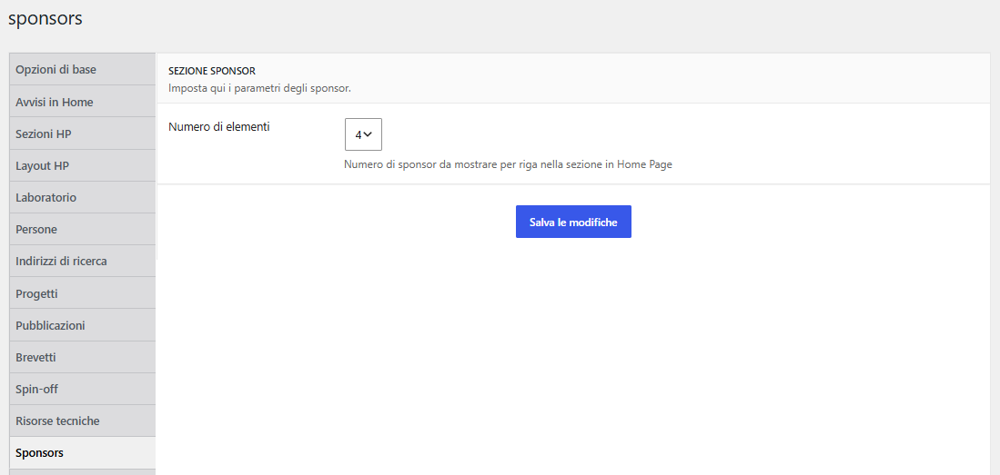

# Manuale Gestione Contenuti Sponsor

## 1. Scopo

Gli Sponsor sono i loghi di partner e collaborazioni mostrati nella home. Non hanno una pagina pubblica propria: si gestiscono nel backoffice e compaiono soltanto nella sezione `Sponsor` della home, quando questa è attiva.

## 2. Creare o modificare uno Sponsor

1. Apri `WP -> Sponsor -> Aggiungi uno Sponsor` oppure `WP -> Sponsor -> Tutti gli Sponsor` per modificare una scheda esistente.
2. Inserisci un titolo chiaro per riconoscere il contenuto nel backoffice.
3. Se necessario, scrivi una breve descrizione nell'editor. La griglia in home mostra il logo, non il testo.
4. In `Campi Sponsor` imposta `Priorità`: i valori più bassi vengono prima.
5. Inserisci `Link esterno` solo quando il logo deve aprire il sito del partner.
6. Imposta il `Logo Identificativo dello Sponsor` come immagine in evidenza, poi pubblica o aggiorna.

Usa immagini nitide, preferibilmente con spazio trasparente intorno al logo. Il tema usa il **titolo del file media** come testo alternativo del logo nella griglia Sponsor: rendilo descrittivo, così identifica il partner anche per chi non vede l'immagine.

## 3. Pubblicazione nella home

Per visualizzare gli Sponsor:

1. Apri `WP -> Configurazione -> Sezioni HP`.
2. Aggiungi o abilita la riga `Sponsor` e salva.
3. Apri `WP -> Configurazione -> Sponsors`.
4. Scegli `Numero di elementi`: 4 o 6 loghi per riga su desktop.
5. Controlla la home pubblica.

Il tema considera al massimo 30 Sponsor pubblicati, ordinati per `Priorità` crescente. Uno Sponsor senza immagine in evidenza non offre un logo affidabile; uno senza `Link esterno` resta visibile ma non cliccabile. Se non esiste alcuno Sponsor pubblicato, la sezione non appare.

L'opzione `Mostra il titolo della sezione` aggiunge un'intestazione per le tecnologie assistive; non visualizza un titolo sopra la griglia. Le traduzioni IT/EN, quando il sito le usa, seguono la procedura del [manuale delle lingue](Manuale-Gestione-Contenuti-Lingue.md).

## 4. Controllo prima della pubblicazione

- Logo corretto e leggibile su sfondo chiaro.
- Titolo del file media descrittivo: è il testo alternativo usato nella griglia Sponsor.
- Priorità coerente con l'ordine desiderato.
- Collegamento esterno completo e verificato, se presente.
- Sponsor pubblicato e sezione `Sponsor` abilitata nella home.
- Griglia controllata su desktop e telefono.

## 12. Esempio nella home

