# Manuale Operatore

Versione: 1.1<br>
Data: 2026-11-12<br>
Tema: `design-laboratori-wordpress-theme`

## 1. Scopo del manuale
Questo documento guida gli operatori editoriali nell'uso quotidiano del sito realizzato con il tema Design Laboratori Italia.
L'obiettivo e' pubblicare e aggiornare contenuti senza intervenire sul codice.

## 2. A chi e' rivolto
- Redattori
- Editor
- Super Editor
- Amministratori

## 3. Ruoli e permessi
Nel progetto e' presente il ruolo `Super Editor`, equivalente a un Editor con permessi aggiuntivi per:
- configurazione del sito (`WP -> Configurazione`)
- gestione menu (`WP -> Aspetto -> Menu`)

Indicazione pratica:
- `Redattore/Editor`: lavora su contenuti.
- `Super Editor`: oltre ai contenuti, gestisce configurazione funzionale del tema.
- `Amministratore`: gestione completa del sito e plugin; solo lui vede le schede `Indico`, `Iris` e `Altro` della configurazione. Vedi il [Manuale Amministratore](Manuale-Amministratore.md).

## 4. Tipi di contenuto principali
Nel menu di amministrazione puoi trovare (nomi variabili in base alla lingua):
- Persone
- Progetti
- News / Notizie
- Eventi
- Luoghi
- Pubblicazioni
- Brevetti
- Spin-off
- Risorse tecniche
- Attivita' di ricerca (indirizzi di ricerca)
- Blog (post WordPress standard)
- Banner

## 5. Flusso editoriale consigliato
Per ogni nuovo contenuto:
1. Crea il contenuto dal tipo corretto (es. Evento, Notizia, Persona).
2. Compila titolo, contenuto, campi aggiuntivi (ACF), immagine in evidenza.
3. Assegna categorie/tassonomie richieste.
4. Verifica lingua (IT/EN) e, se necessario, crea la traduzione.
5. Salva bozza.
6. Verifica anteprima desktop/mobile.
7. Pubblica.

Checklist minima prima della pubblicazione:
- Titolo chiaro e coerente
- Data corretta (se evento/notizia)
- Link funzionanti
- Immagine presente e pertinente
- Traduzione presente se il contenuto deve essere bilingue

## 6. Gestione pagine e archivi
Il tema include pagine/template gia' predisposti, ad esempio:
- `Il Laboratorio`
- `Persone`
- `Progetti`
- `Eventi`
- `Notizie`
- `Pubblicazioni`
- `Brevetti`
- `Spin-off`
- `Risorse Tecniche`
- `Mappa del sito`
- `Contatti`
- `Ricerca`

Nota operativa:
- Le pagine archivio mostrano automaticamente i contenuti dei relativi post type.
- In caso di risultati inattesi, controlla prima filtri, tassonomie e stato di pubblicazione dei contenuti.

### Card delle sottopagine in una pagina
Nella modifica di una pagina, il campo `Mostra le sottopagine come card` mostra, prima del testo della pagina e sotto il titolo `In questa sezione`, una card per ciascuna sottopagina diretta (titolo, riassunto e link `Vai al servizio`).
- Le sottopagine seguono l'ordine della pagina (`Attributi pagina > Ordine`), poi il titolo.
- Il riassunto è il campo `Riassunto` della sottopagina (ora disponibile anche per le pagine). Se è vuoto, la card usa l'inizio del testo della sottopagina, tagliato a 30 parole.
- Le sottopagine in bozza o protette da password non compaiono. Se la pagina stessa è protetta, le card compaiono solo dopo aver inserito la password.
- Se non ci sono sottopagine pubblicate non compare nessun elenco, anche con il campo attivo.
- Per provare le card senza scrivere pagine a mano: scarica l'esempio italiano o inglese da `Strumenti DLI > Importa > Pagine` e importalo (prima in simulazione, poi con la conferma): crea quattro pagine principali (`Open Access`, `Research Data`, `Research Assessment`, `Monitoring`; solo la seconda ha sottopagine: quattro, con le loro sottopagine, per 15 pagine per lingua), con riassunti e, se accendi la casella «Inserisci testo Lorem ipsum nelle nuove pagine», testi lorem ipsum di lunghezza diversa. Le quattro pagine principali e le sottopagine `Pianificare`, `Gestire` e `Condividere` sono anche promosse alla home, per provare le sezioni `Card di navigazione` (4 card) e `Navigazione per pagine` (4 gruppi); la lingua si sceglie nel modulo, e importando i due esempi le versioni sono collegate come traduzioni. L'importazione può essere ripetuta senza duplicare nulla; lo strumento non cancella pagine: per toglierle si usa il cestino di WordPress. Sono contenuti finti: non usarli su un sito di produzione. Servono i permessi di configurazione del sito e di pubblicazione delle pagine.
- Il campo `Promuovi in Home` fa comparire la pagina nella sezione `Card di navigazione` della home (fino a 6 pagine, numero modificabile in `Sezioni HP`; nell'ordine del campo `Ordine` della pagina e poi per titolo; non compaiono le pagine in bozza o protette da password). Per default la sezione mostra solo le pagine di primo livello, cioè senza pagina genitore: una sottopagina promossa non diventa una card, a meno che nella riga di `Sezioni HP` si scelga un livello più ampio (`Livello delle pagine`). La stessa pagina promossa compare anche nella sezione `Navigazione per pagine` se ha sottopagine pubblicate, a qualsiasi livello. Le sezioni vanno aggiunte in `Configurazione > Sezioni HP` e i loro testi si scrivono in `Layout HP`; finché non sono attive il campo non cambia nulla. La tabella dei criteri con un esempio è nel manuale di configurazione, tab `Layout HP`.
- La sezione `Pannello tab` della home mostra una serie di tab, ognuno con un'etichetta, un testo e, se vuoi, un elenco di pagine collegate. I tab si scrivono in `Configurazione > Layout HP` (gruppo `Tab`: `Etichetta`, `Etichetta ENG`, `Descrizione`, `Descrizione ENG`, `Pagine collegate`) e si riordinano con le frecce di ogni riga; la sezione si aggiunge e si ordina in `Configurazione > Sezioni HP`. Il primo tab è quello aperto. Un tab senza etichetta, o senza testo e senza pagine da mostrare, non compare. In inglese, ciò che manca in inglese si legge in italiano; le pagine collegate si scelgono in italiano e sul sito inglese compare la traduzione. Il dettaglio dei criteri è nel manuale di configurazione, tab `Layout HP`.
- La sezione `Indice di una pagina` della home mostra l'indice di una pagina che scegli tu nella riga di `Configurazione > Sezioni HP` (campo `Pagina`): le sue sottopagine dirette sono le colonne, con il titolo, e le loro sottopagine sono i link. Una sottopagina senza figli non compare. Si può aggiungere più volte, anche con la stessa pagina: a riga chiusa ogni copia mostra la pagina scelta (`Indice di una pagina — Ricerca`) e ha i suoi numeri e il suo sfondo. Sul sito inglese compare la traduzione della pagina, e senza traduzione la sezione non compare. Il dettaglio dei criteri è nel manuale di configurazione, tab `Layout HP`.

## 7. Configurazione del tema (`WP -> Configurazione`)
Da questa sezione si gestiscono i parametri globali del sito (testi, sezioni home, contatti, ecc.).

Suggerimenti:
- Modifica una sezione alla volta.
- Salva e verifica il frontend dopo ogni modifica.
- Evita di incollare codice HTML/JS non necessario nei campi testuali.

## 8. Home page: cosa puo' gestire l'operatore

Questo capitolo è la guida pratica per scegliere e comporre le sezioni della home. Per modificare `Configurazione` serve il ruolo **Super Editor** o **Amministratore**; chi gestisce soltanto i contenuti può preparare pagine, notizie e altri elementi, secondo i propri permessi.

### 8.1 Scegliere le sezioni

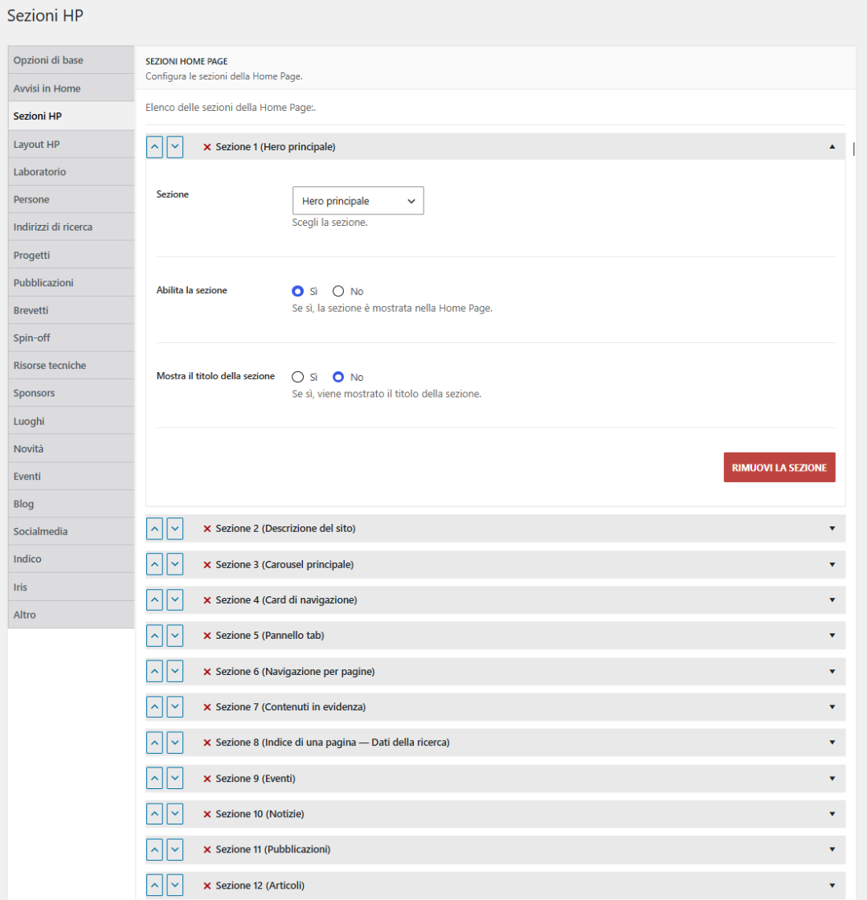

Non occorre usarle tutte: scegli quelle utili al visitatore ed evita di ripetere lo stesso contenuto in troppi blocchi.

| Sezione | Quando usarla | Da dove arrivano i contenuti |
|---|---|---|
| Hero principale | Presentare un messaggio con immagine e un invito all'azione | Testi e immagine in `Layout HP` |
| Descrizione del sito | Spiegare brevemente identità e attività del laboratorio | Scheda `Laboratorio` |
| Carousel principale | Mettere in primo piano più contenuti a scorrimento | Selezione automatica o manuale in `Layout HP` |
| Contenuti in evidenza | Affiancare fino a tre gruppi di contenuti di tipi diversi | Box in `Layout HP` e contenuti promossi in home |
| Card di navigazione | Offrire accessi sintetici alle pagine principali | Pagine con `Promuovi in Home` |
| Navigazione per pagine | Mostrare più gruppi di pagine con le relative sottopagine | Pagine promosse che hanno sottopagine |
| Indice di una pagina | Mostrare l'albero di una pagina scelta, anche in più punti della home | Pagina scelta nella singola riga di `Sezioni HP` |
| Pannello tab | Organizzare testi e link per argomenti, mostrando un pannello alla volta | Tab compilati in `Layout HP` |
| Eventi | Dare visibilità agli eventi selezionati dalla redazione | Eventi con `Promuovi in Home` |
| Notizie | Evidenziare le notizie selezionate dalla redazione | Notizie con `Promuovi in Home` |
| Pubblicazioni | Presentare una selezione di pubblicazioni | Pubblicazioni con `Promuovi in Home` |
| Articoli | Valorizzare i contributi del blog | Articoli WordPress con `Promuovi in Home` |
| Banner | Promuovere iniziative con un richiamo grafico e un collegamento | Contenuti di tipo Banner |
| Sponsor | Mostrare loghi di partner e collaborazioni | Contenuti di tipo Sponsor |
| Video | Inserire un video di presentazione | URL nella riga di `Sezioni HP` |

Gli **Avvisi in Home** sono messaggi separati da questo elenco: si configurano nella scheda omonima e non si aggiungono né si riordinano in `Sezioni HP` (vedi §8.18).

### 8.2 Aggiungere, ordinare e configurare

1. Prepara i contenuti necessari e pubblicali, se sono pagine o altri contenuti editoriali.
2. Apri `Configurazione > Sezioni HP`, aggiungi una riga e scegli la sezione.
3. Attiva `Abilita la sezione` e compila le opzioni che compaiono per quella sezione. Le frecce nell'intestazione della riga ne cambiano l'ordine; la `✕` elimina la riga dalla home, non i contenuti originali.
4. Completa testi e contenuti nelle schede indicate sotto e salva ogni scheda modificata: `Sezioni HP` e `Layout HP` sono configurazioni distinte.
5. Controlla la home in italiano e in inglese, su desktop e su telefono; prova anche i collegamenti.

`Mostra il titolo della sezione` è disponibile nelle righe, ma il suo effetto dipende dal modello: non nasconde il titolo della Hero, della descrizione del sito o dei singoli Banner (la sezione Banner ha il titolo scritto nella riga, che si vede solo se il campo è su Sì); alcuni blocchi usano un titolo solo per le tecnologie assistive. Sfondo e limiti numerici compaiono soltanto nelle sezioni che li supportano. Il dettaglio dei campi resta nel [Manuale del pannello Configurazione, §§4.3–4.4](Manuale-Utente-Pannello-Configurazione.md).

**Si possono ripetere solo alcune sezioni.** Nel menu `Sezione` di una riga, una sezione che può stare in home una volta sola (Hero, Descrizione del sito, Carousel, Contenuti in evidenza, Card di navigazione, Navigazione per pagine, Pannello tab, Eventi, Notizie, Pubblicazioni, Articoli, Sponsor) compare disattivata se è già in un'altra riga; si riattiva quando togli quella riga. Indice di una pagina, Video e Banner si possono ripetere. Le righe già salvate non vengono cambiate. **Ripetere una sezione non significa ottenere contenuti indipendenti.** L'Indice di una pagina consente una pagina diversa per ogni riga. Il Video ha invece un indirizzo per ogni riga, scritto nella riga stessa. Anche il Banner è autonomo per ogni riga: modalità, numero (in automatico), banner scelti (in manuale) e titolo si scrivono nella riga. Il Pannello tab legge invece un'unica configurazione in `Layout HP`: usa una sola riga, perché ripeterlo mostra gli stessi tab.

### 8.3 Hero principale

È un grande richiamo con immagine di sfondo, titolo, testo e pulsante. È adatta, per esempio, a presentare il laboratorio e rimandare alla pagina «Chi siamo».

In `Configurazione > Layout HP` scegli la dimensione grande o piccola, compila titolo e testo IT/EN, seleziona l'immagine e indica etichetta e URL del pulsante. Aggiungi e abilita `Hero principale` in `Sezioni HP`.

L'immagine di sfondo è una fascia larga e bassa: carica un'immagine panoramica di 1920 × 600 px, con il soggetto al centro. Sotto il campo trovi l'indicazione del formato; tutte le posizioni sono nella guida [Gestione delle immagini](../HowTo/Gestione-delle-immagini.md).

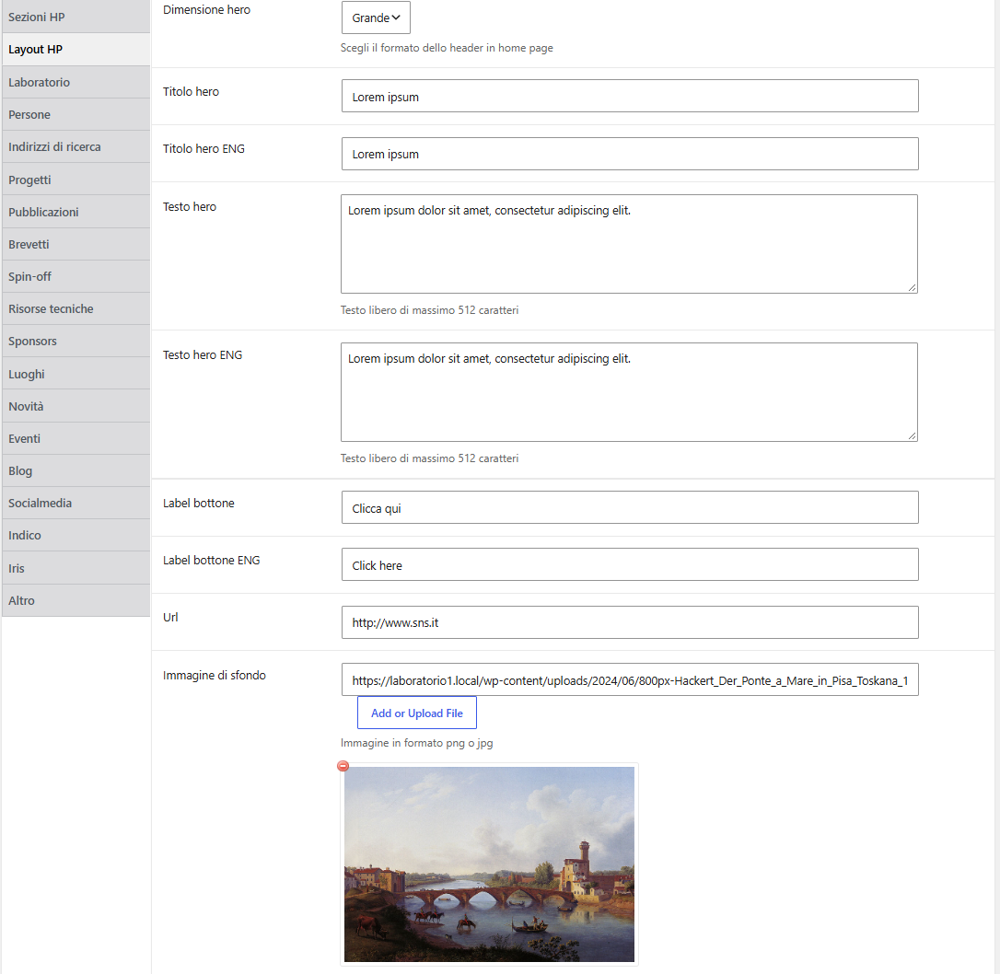

*Configurazione dell'hero principale in Layout HP.*

La Hero è mostrata quando è abilitata, anche se alcuni campi sono vuoti: non lasciare un blocco privo di messaggio. Senza URL il pulsante non compare. Il testo descrittivo è nascosto sugli schermi più piccoli: metti le informazioni indispensabili nel titolo e nella pagina di destinazione, non soltanto nella descrizione.

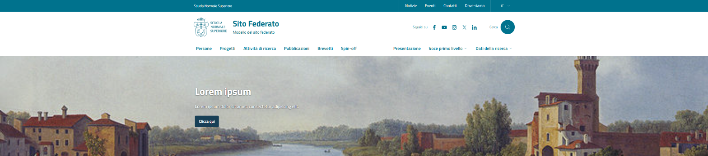

*Risultato dell'hero principale nella home.*

### 8.4 Descrizione del sito

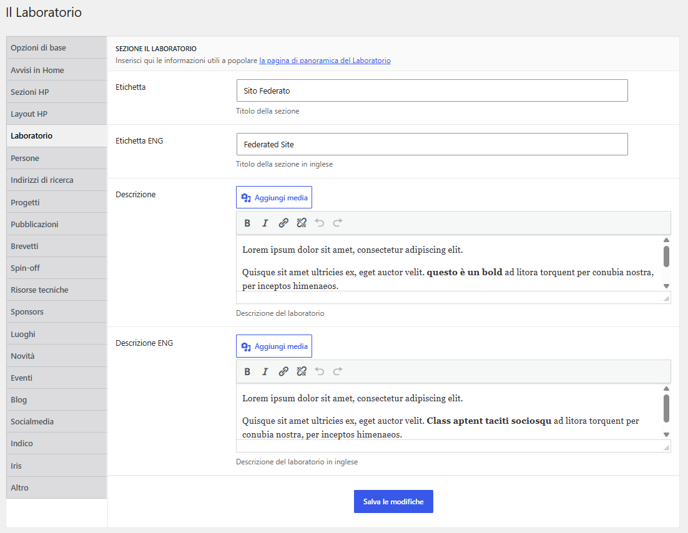

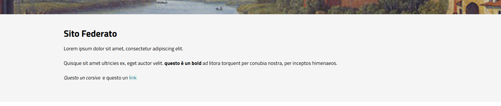

Mostra il testo di presentazione del laboratorio, senza dover creare un articolo. Usala per una breve introduzione a missione e attività.

Compila etichetta e descrizione in `Configurazione > Laboratorio`, nelle lingue previste, e abilita `Descrizione del sito` in `Sezioni HP`. Senza descrizione da mostrare il blocco non compare. L'etichetta è il titolo visibile del blocco; non si controlla da `Mostra il titolo della sezione`.

### 8.5 Carousel principale

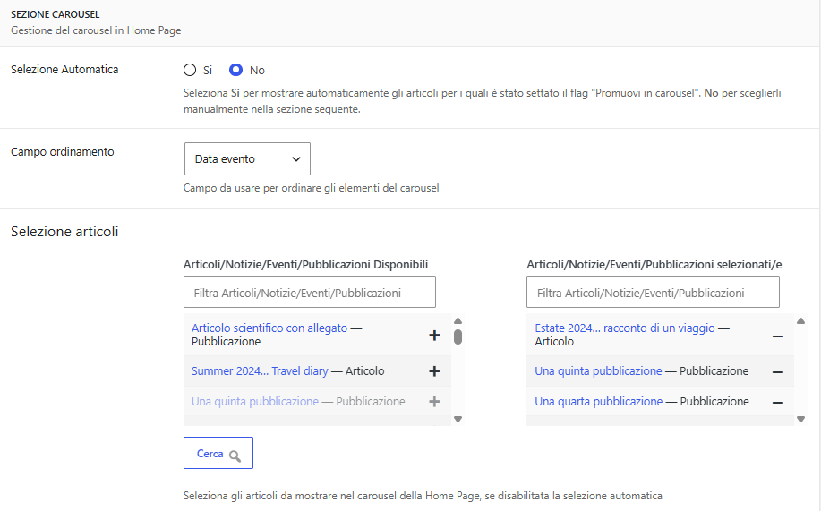

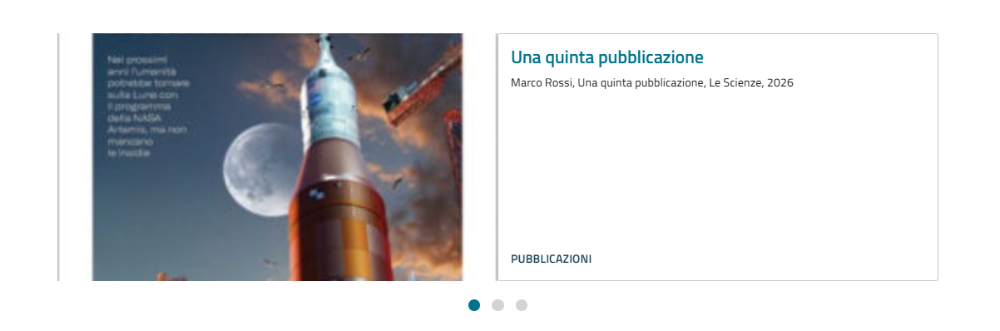

Mostra schede a scorrimento con immagine, titolo e sintesi. È distinto dal carousel della sezione Eventi. La selezione manuale propone articoli del blog, notizie, eventi e pubblicazioni; quella automatica può includere anche brevetti, progetti, spin-off e risorse tecniche con `Promuovi in carousel`.

In `Configurazione > Layout HP` scegli la selezione automatica, basata sul campo `Promuovi in carousel` dei contenuti, oppure disattivala e scegli manualmente gli elementi. Imposta anche il criterio di ordinamento disponibile: selezione manuale non significa ordine libero, perché il tema riordina comunque per il criterio di data scelto, dal più recente.

Abilita `Carousel principale` in `Sezioni HP`. Senza elementi non viene semplicemente nascosto: appare un messaggio che invita a configurarlo; disabilitalo se non intendi usarlo. Nei siti multilingua verifica le traduzioni dei contenuti scelti. Esempio: metti in primo piano una notizia, un evento e una pubblicazione, con immagini coerenti e titoli brevi.

### 8.6 Contenuti in evidenza

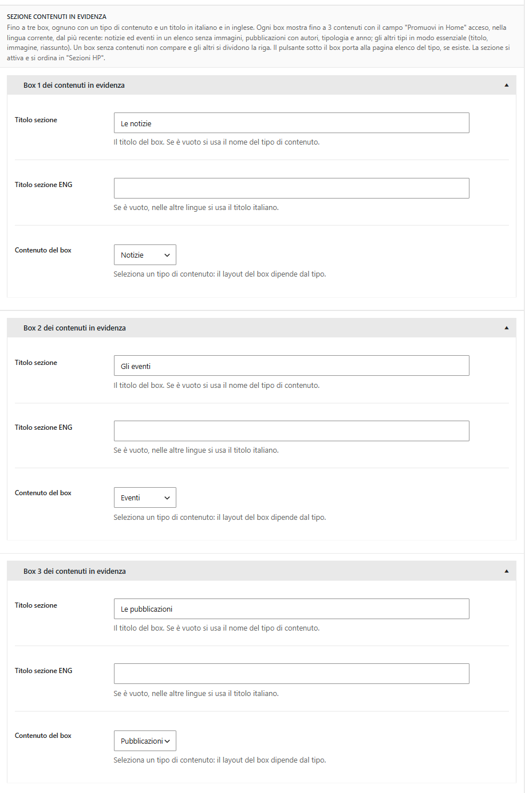

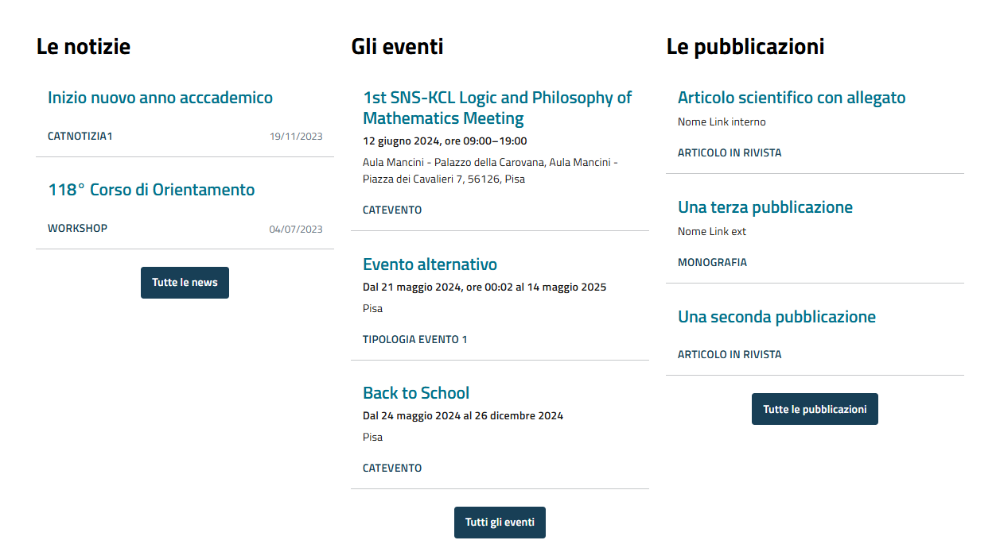

Affianca fino a tre box, ciascuno dedicato a un tipo di contenuto. Usalo, per esempio, per accostare «Notizie», «Eventi» e «Pubblicazioni» senza tre sezioni estese consecutive.

Configura in `Layout HP` il tipo e il titolo IT/EN di ogni box; pubblica i contenuti e attiva il loro campo `Promuovi in Home`. Ogni box mostra fino a 3 elementi, dai più recenti per pubblicazione. Il tipo decide l'aspetto: non c'è un template da scegliere per ciascun box.

Attiva la sezione in `Sezioni HP`. I box vuoti non compaiono e quelli rimasti si dividono lo spazio; se sono tutti vuoti non compare la sezione. Il collegamento all'elenco completo compare quando esiste la pagina elenco pubblicata nella lingua corrente. Per i dettagli dei contenuti consulta i rispettivi manuali, per esempio quello delle [Pubblicazioni](Manuale-Gestione-Contenuti-Pubblicazioni.md).

### 8.7 Card di navigazione

Mostra pagine come card di accesso, per esempio «Ricerca», «Servizi» e «Contatti». La scelta non è un elenco manuale dentro la sezione: dipende dal campo `Promuovi in Home` delle pagine.

Pubblica le pagine, attiva il campo e imposta `Ordine` in `Attributi pagina`; a parità di ordine si usa il titolo. In `Layout HP` scrivi titolo e sottotitolo della sezione. In `Sezioni HP` aggiungi `Card di navigazione`, scegli sfondo, numero massimo e livello delle pagine.

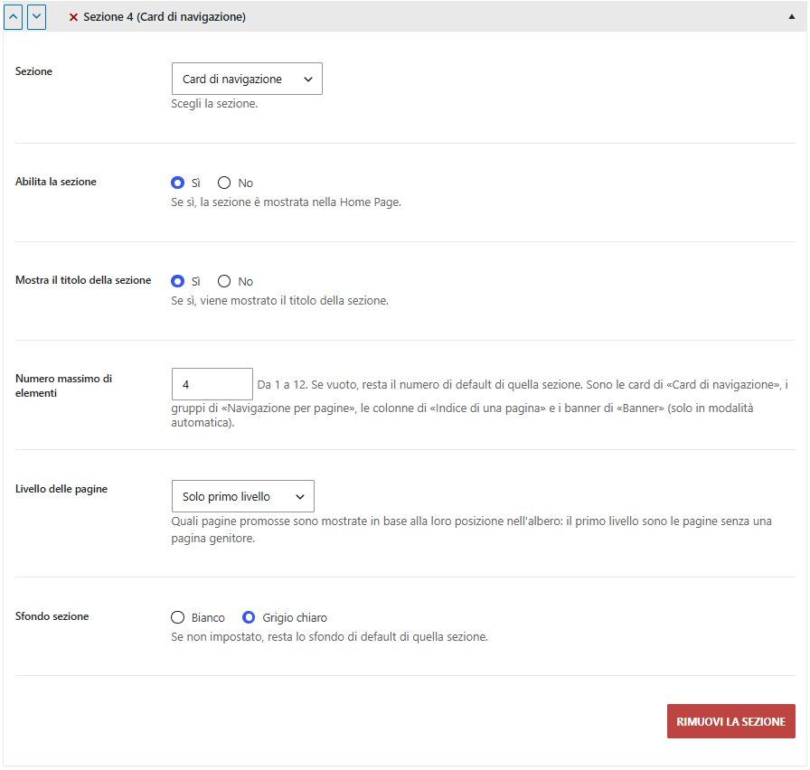

*Configurazione della sezione Card di navigazione.*

Di default compaiono fino a 6 pagine di primo livello, cioè senza genitore. Puoi scegliere fino al secondo o terzo livello, oppure tutti i livelli, e un limite da 1 a 12. Bozze e pagine protette non compaiono; senza pagine idonee il blocco è nascosto. Il titolo configurato compare soltanto se ne abiliti la visualizzazione; il sottotitolo non vuoto rimane visibile. Ripetere la sezione non permette di scegliere due elenchi manuali indipendenti.

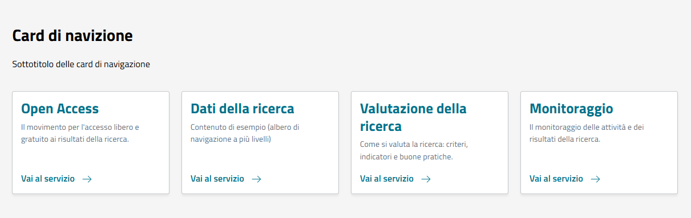

*Risultato della sezione Card di navigazione nella home.*

### 8.8 Navigazione per pagine

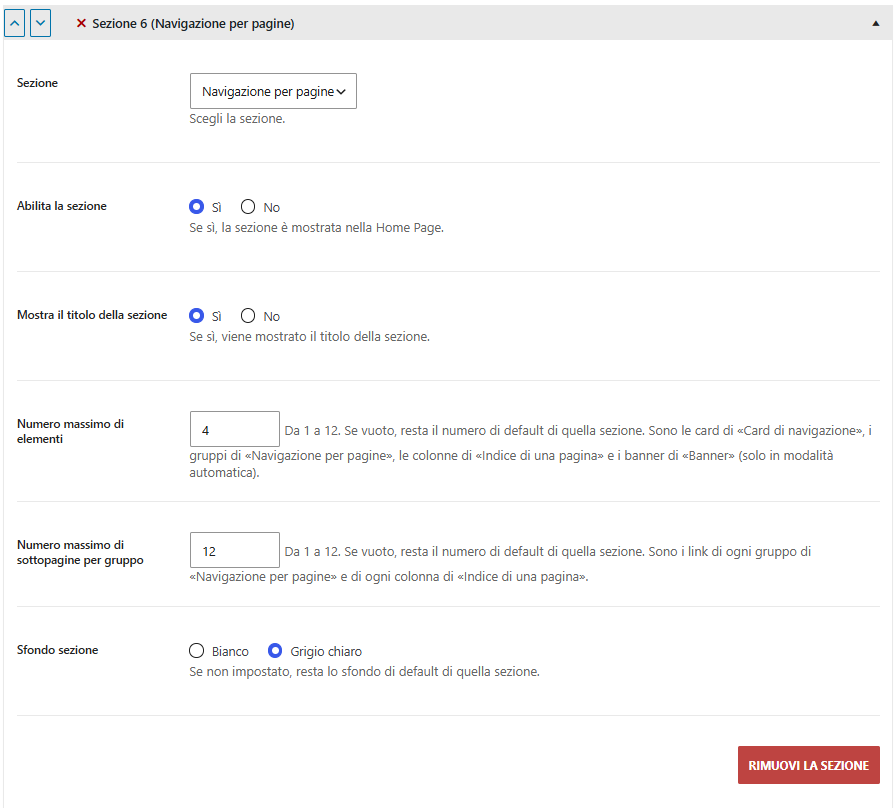

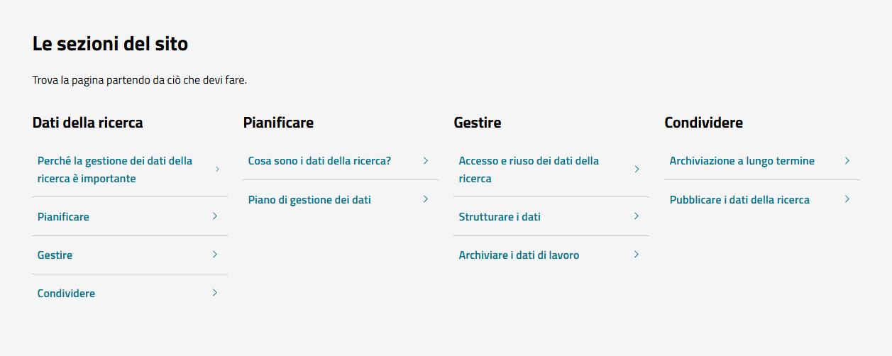

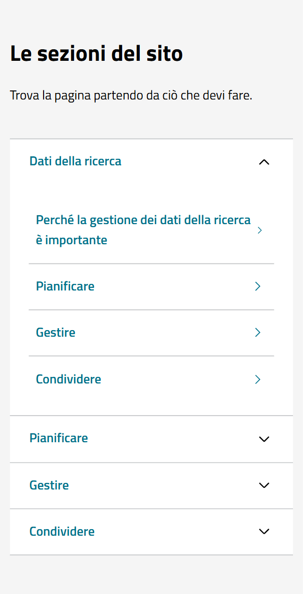

Mostra gruppi di link: il nome di una pagina e sotto le sue sottopagine dirette. È utile per presentare, per esempio, i servizi organizzati in «Dati», «Valutazione» e «Supporto».

Attiva `Promuovi in Home` nelle pagine che devono diventare gruppi e assegna loro sottopagine pubblicate. Scrivi titolo e sottotitolo in `Layout HP`; aggiungi la sezione in `Sezioni HP`, scegliendo sfondo, numero massimo di gruppi e link per gruppo (da 1 a 12; valori iniziali 4 e 4).

Le pagine possono essere a qualsiasi livello dell'albero; una pagina promossa senza sottopagine non forma un gruppo. Gruppi e link seguono `Ordine`, poi titolo; bozze e pagine protette sono escluse. Il titolo del gruppo non è un collegamento. Sul telefono i gruppi diventano un accordion, con il primo aperto; senza gruppi il blocco non compare. Non usa i menu del sito né una scelta manuale di pagine nella riga.

### 8.9 Indice di una pagina

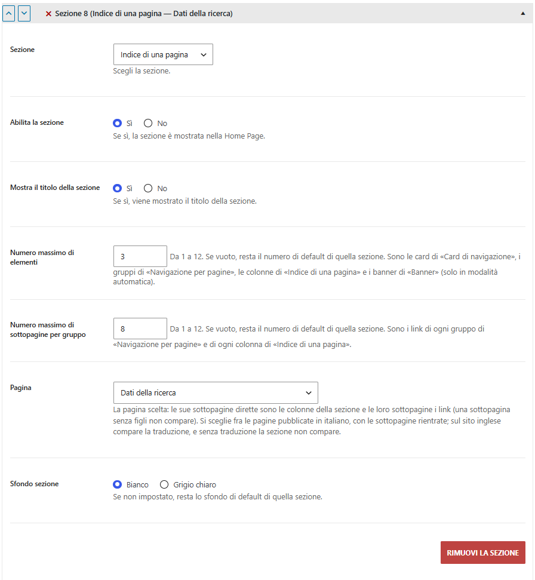

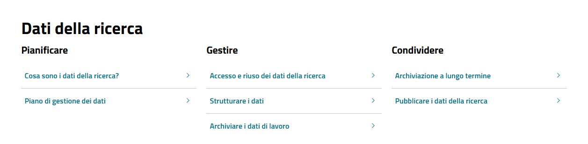

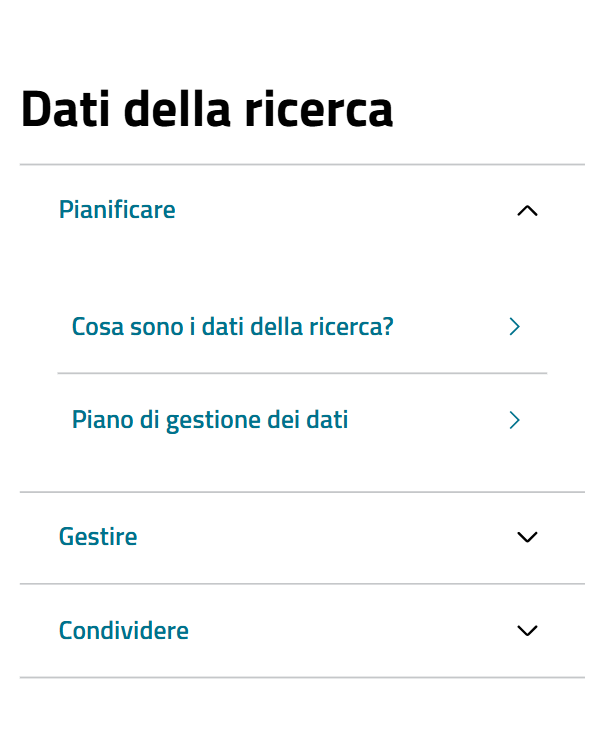

Mostra l'albero di una pagina scelta: le sue sottopagine dirette diventano colonne e le sottopagine di queste diventano link. Non dipende da `Promuovi in Home` e non elenca semplicemente tutte le pagine del sito.

In `Sezioni HP` aggiungi `Indice di una pagina` e scegli la `Pagina` fra quelle italiane pubblicate e senza password. Nella stessa riga imposta titolo visibile, sfondo, numero massimo di colonne e link per colonna (da 1 a 12; valori iniziali 4 e 6). Non ci sono testi da compilare in `Layout HP`: il titolo è quello della pagina scelta.

Esempio di gerarchia, costruita tramite il campo `Pagina genitore`:

```text
Ricerca                         ← pagina scelta
├── Progetti                    ← colonna
│   ├── Progetti attivi          ← link
│   └── Progetti conclusi        ← link
├── Pubblicazioni               ← colonna
│   └── Rapporti                 ← link
└── Contatti                    ← senza figli: non forma una colonna
```

Una pagina non pubblicata, protetta o senza gruppi utilizzabili non produce la sezione. Sul sito inglese si usa la traduzione: senza traduzione della pagina scelta non compare l'indice. Sul telefono i gruppi diventano un accordion.

Puoi aggiungere più indici, anche della stessa pagina: per esempio «Ricerca» con 4 colonne e «Servizi» con 2. Ogni riga conserva pagina, limiti e sfondo propri; a riga chiusa la pagina scelta compare nel nome, così distingui le copie. Una scelta diventata non visibile resta riconoscibile nel pannello, ma non rende nuovamente pubblica la pagina.

### 8.10 Pannello tab

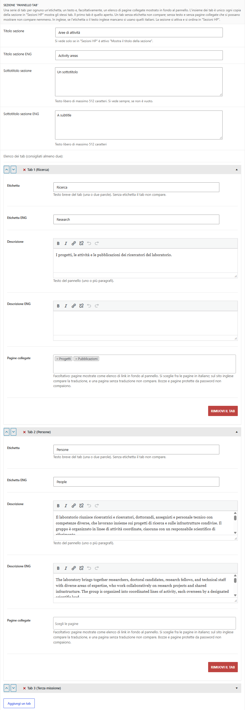

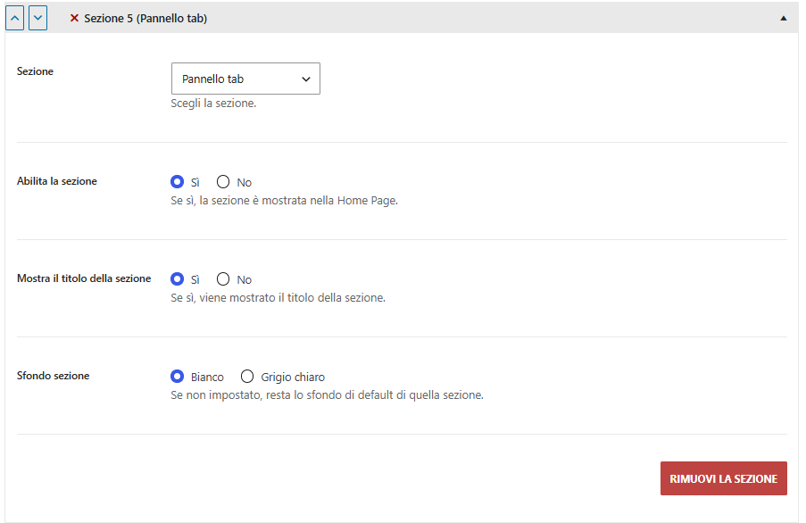

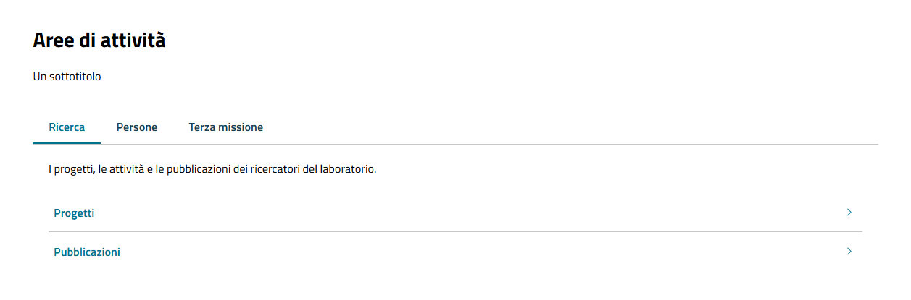

Organizza informazioni in pannelli selezionabili, per esempio «Studiare», «Collaborare» e «Visitare». È una scelta editoriale manuale, non una vista automatica dell'albero delle pagine.

In `Layout HP` compila titolo e sottotitolo e aggiungi le righe del gruppo `Tab`: etichetta, descrizione e pagine collegate facoltative, con le versioni inglesi dei testi. Riordina i tab tramite le frecce. Aggiungi e abilita `Pannello tab` in `Sezioni HP`, scegliendo lo sfondo.

Il primo tab è aperto. Un tab senza etichetta, oppure senza descrizione e senza pagine visibili, non compare; senza tab validi non compare la sezione. Le pagine si scelgono in italiano: sul sito inglese si usano le traduzioni e si omettono quelle mancanti; etichetta e descrizione inglesi vuote riprendono il testo italiano. Con la tastiera le frecce spostano il focus, `Invio` o `Spazio` attivano il tab. Tutte le eventuali copie della sezione leggono lo stesso insieme di tab, non insiemi indipendenti.

### 8.11 Eventi

Mostra un carousel di massimo 6 eventi pubblicati con `Promuovi in Home` attivo, ordinati per data di inizio decrescente. È una selezione editoriale: non equivale automaticamente ai soli eventi futuri.

Prepara gli eventi con date, immagine e descrizione, poi abilita `Eventi` in `Sezioni HP`; puoi scegliere se mostrarne il titolo. Senza eventi promossi la sezione non compare. Esempio: evidenzia le conferenze del laboratorio; togli la promozione agli eventi che non vuoi più in home. Per i campi consulta il [manuale Eventi](Manuale-Gestione-Contenuti-Eventi.md).

### 8.12 Notizie

Mostra fino a 3 notizie promosse, dalla più recente per data di pubblicazione, con titolo, immagine e sintesi. Usala per le comunicazioni che meritano visibilità immediata.

Pubblica le notizie e attiva `Promuovi in Home`, poi abilita `Notizie` in `Sezioni HP`, con o senza titolo. Senza notizie idonee il blocco non compare. La selezione non coincide con tutti i contenuti del sito e non si ordina trascinando le righe di `Sezioni HP`: quelle frecce spostano l'intero blocco. Vedi il [manuale Notizie](Manuale-Gestione-Contenuti-Notizie.md).

### 8.13 Pubblicazioni

Presenta fino a 3 pubblicazioni promosse, dalla più recente per data di pubblicazione su WordPress, non per anno bibliografico. Le schede mostrano i dati bibliografici disponibili, compreso l'anno.

Compila i contenuti e attiva `Promuovi in Home`, poi abilita `Pubblicazioni` in `Sezioni HP`, scegliendo se mostrarne il titolo. Senza pubblicazioni idonee la sezione non compare; il pulsante all'elenco completo richiede la pagina elenco nella lingua corrente. Esempio: seleziona i risultati di ricerca che vuoi valorizzare, senza modificare l'anno bibliografico per cambiarne l'ordine. Per campi, file e destinazioni dei link usa il [manuale Pubblicazioni](Manuale-Gestione-Contenuti-Pubblicazioni.md).

### 8.14 Articoli

Mostra fino a 3 articoli del blog con `Promuovi in Home`, dai più recenti per pubblicazione. Non legge i contenuti di tipo Notizia: usa gli articoli WordPress standard.

Pubblica e promuovi gli articoli, poi abilita `Articoli` in `Sezioni HP`; sul sito il titolo del blocco è «Blog», se visibile. Senza articoli idonei la sezione non compare. Esempio: usa il blog per approfondimenti e racconti delle attività, lasciando le comunicazioni brevi alla sezione Notizie. Vedi il [manuale Blog](Manuale-Gestione-Contenuti-Blog.md).

### 8.15 Banner

Mostra richiami grafici ordinati per `Priorità` crescente (3 se non scegli un numero) oppure quelli che scegli a mano (fino a 12). Può servire a promuovere un bando o un'iniziativa; non è la scheda pubblica di un contenuto navigabile autonomamente.

Crea e pubblica i contenuti di tipo Banner con titolo, testo, immagine in evidenza, priorità ed eventuali etichetta e link del pulsante. L'immagine è una fascia larga e bassa che cresce con il testo: usa un'immagine panoramica di 1920 × 480 px con il soggetto al centro (vedi [Gestione delle immagini](../HowTo/Gestione-delle-immagini.md)). Abilita `Banner` in `Sezioni HP`: non serve il campo `Promuovi in Home`. Senza Banner da mostrare il blocco non compare; senza link non compare il pulsante. Il testo descrittivo è nascosto sugli schermi più piccoli: il messaggio essenziale deve essere chiaro anche nel titolo.

Ogni riga ha il campo `Come scegliere i banner`: **Automatico** (i banner pubblicati per `Priorità` crescente, come è sempre stato) oppure **Manuale** (i banner che scegli in `Banner scelti`, nell'ordine in cui li scegli). In manuale, senza banner scelti la sezione non compare; un banner in bozza, nel cestino o senza la traduzione nella lingua della pagina non compare; si può scegliere lo stesso banner in due sezioni. `Numero massimo di elementi` (da 1 a 12; se vuoto, 3) vale **solo in modalità automatica**: in manuale compaiono tutti i banner scelti. La riga ha anche, se vuoi, un titolo in italiano e in inglese (`Titolo della sezione` e `Titolo della sezione ENG`, come il Video): compare solo se esiste nella lingua della pagina e se `Mostra il titolo della sezione` è su Sì; senza titolo i banner sono come sono sempre stati. Per i campi consulta il [manuale Banner](Manuale-Gestione-Contenuti-Banner.md).

### 8.16 Sponsor

Mostra una griglia di loghi, per esempio partner e collaborazioni, ordinati per `Priorità` crescente. Pubblica i contenuti Sponsor con immagine in evidenza, priorità e collegamento esterno, se disponibile. Il logo viene mostrato alto al massimo 64 px: usa un logo orizzontale su fondo trasparente, alto almeno 128 px (vedi [Gestione delle immagini](../HowTo/Gestione-delle-immagini.md)).

Abilita `Sponsor` in `Sezioni HP` e scegli gli elementi per riga in `Configurazione > Sponsors`. Non si selezionano con `Promuovi in Home`: il modello legge fino a 30 Sponsor pubblicati. Senza risultati la sezione non compare; senza collegamento un logo non è cliccabile. La voce di visualizzazione del titolo non produce un'intestazione visibile sopra i loghi. Per creare i loghi, l'ordine e i collegamenti consulta il [manuale Sponsor](Manuale-Gestione-Contenuti-Sponsor.md).

### 8.17 Video

Mostra un video di presentazione con il player condiviso del tema, predisposto per YouTube. In `Configurazione > Sezioni HP` scegli `Video` e scrivi l'indirizzo nel campo `URL del video` della riga, poi abilita la sezione, con o senza titolo. Puoi scegliere lo sfondo della sezione, bianco o grigio chiaro (se non scegli, resta il grigio chiaro di prima). Quando la riga è chiusa il nome mostra il titolo italiano, se c'è, altrimenti il codice del video (per esempio `Video — Intervista` o `Video — aaaaaaaaaaa`), così le sezioni Video si distinguono.

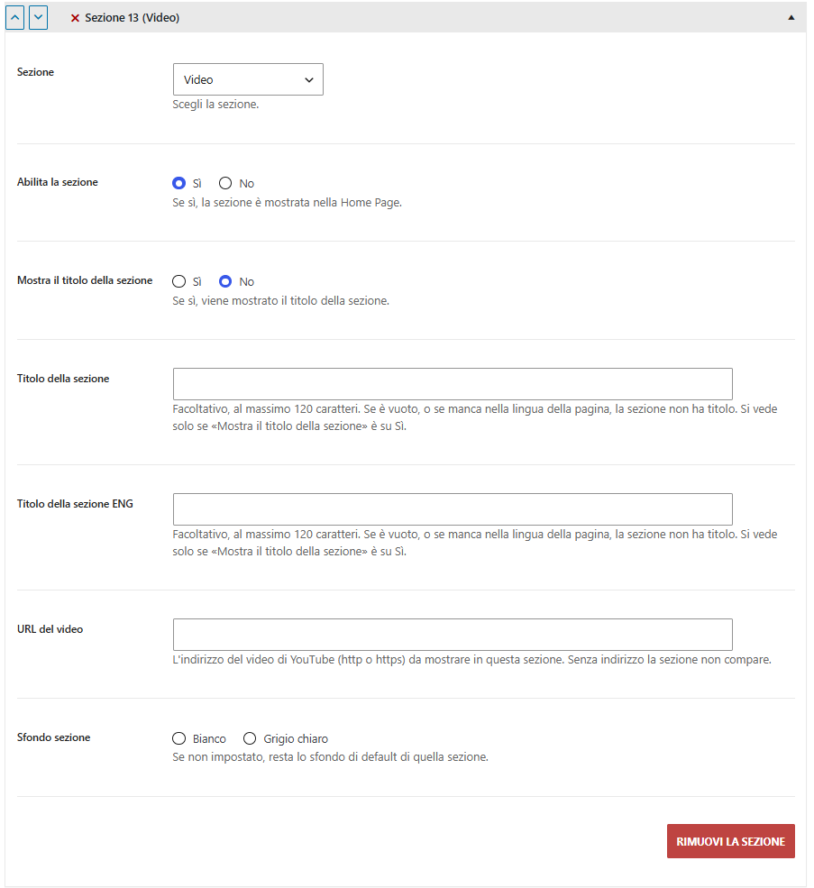

*Configurazione della sezione Video in Sezioni HP.*

Ogni riga ha il suo video e, se vuoi, il suo titolo, in italiano e in inglese (`Titolo della sezione` e `Titolo della sezione ENG`, al massimo 120 caratteri): il titolo compare solo se esiste nella lingua della pagina (un titolo inglese mancante non viene sostituito da quello italiano) e solo se `Mostra il titolo della sezione` è su Sì; altrimenti la sezione non ha titolo. Puoi aggiungere più sezioni `Video` con indirizzi e titoli diversi. Senza URL la sezione non compare. L'indirizzo è lo stesso per le due lingue. Il campo `Home Page Video URL` che era in `Layout HP` non c'è più: dopo l'aggiornamento il video della home non si vede finché non scrivi l'indirizzo nella riga (il vecchio valore non viene copiato). Il player presenta il consenso ai cookie YouTube: la sola presenza del riquadro non significa che la riproduzione sia già attiva. Controlla avvio e consenso sul sito finale. Esempio: inserisci il video istituzionale del laboratorio; non presumere che qualsiasi URL video sia supportato.


*Risultato della sezione Video nella home.*

### 8.18 Avvisi e controlli finali

Per un messaggio breve, come una chiusura temporanea, usa `Configurazione > Avvisi in Home`: aggiungi testo, colore e collegamento facoltativo. Non è una sezione del catalogo `Sezioni HP` e non si sposta con le sue frecce. La configurazione attuale non offre una scadenza automatica: rimuovi manualmente gli avvisi non più validi.

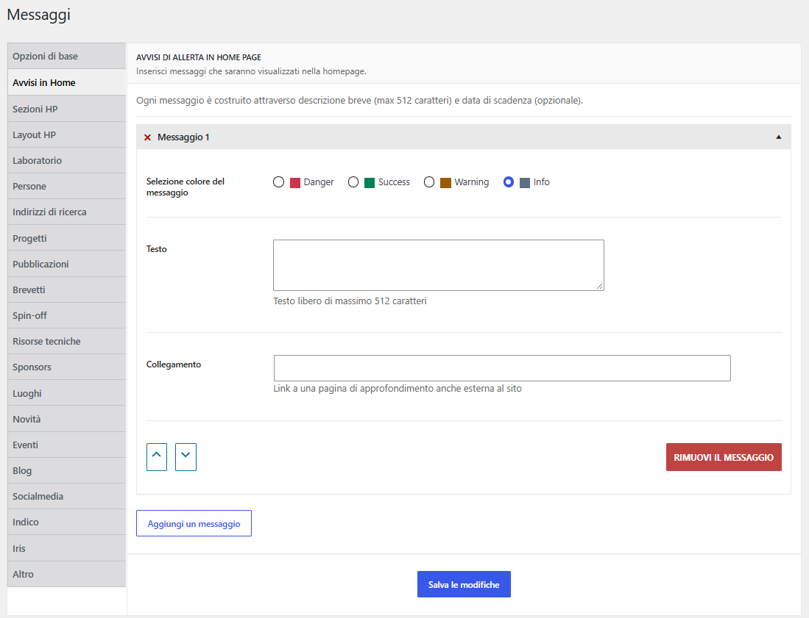

*Configurazione dell'Avviso in Home.*

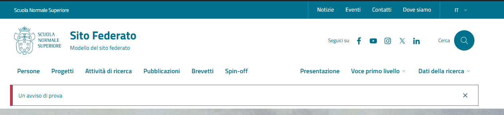

*Risultato dell'Avviso in Home.*

Se un blocco manca, controlla nell'ordine:

1. Hai aggiunto la riga, abilitato la sezione e salvato?
2. Hai salvato anche i testi o le selezioni nella scheda separata?
3. Esistono contenuti che rispettano i criteri specifici: promozione, pagina scelta, gerarchia, stato pubblicato, lingua e limiti?
4. Sul sito inglese esistono le traduzioni necessarie? Le sezioni che elencano pagine escludono bozze e pagine protette.
5. I pulsanti portano alla destinazione corretta e le pagine elenco esistono nella lingua corrente?

Controlla infine la home anche sul telefono e con la tastiera. Per confrontare in dettaglio i criteri delle quattro sezioni che mostrano pagine, usa la tabella e l'esempio nel [manuale di configurazione, §4.4](Manuale-Utente-Pannello-Configurazione.md).

## 9. Menu e struttura di navigazione
Percorso: `WP -> Aspetto -> Menu`

Le posizioni sono cinque, ognuna con la propria variante in inglese (gestita separatamente con Polylang):
- `Menu principale di link a sinistra`: la barra di navigazione, con voci semplici o con sottovoci.
- `Menu secondario multilevel a destra`: pensato per le pagine base.
- `Menu header di link in alto a destra`, `Menu link utili - footer` e `Menu a piè di pagina di link - footer`: link semplici.

Una voce con sottovoci diventa un menu a tendina. Se la voce ha un indirizzo proprio, il menu a tendina comincia con un link alla voce stessa. Una voce senza indirizzo (`#` o vuoto) e senza sottovoci raggiungibili non viene mostrata, e una sottovoce senza indirizzo neppure.

Buone pratiche:
- Mantieni etichette brevi e chiare.
- Evita duplicati nello stesso livello.
- Dopo modifiche importanti, controlla header, footer e mappa del sito.

## 10. Lingue (IT/EN)
Il tema supporta italiano e inglese con Polylang.

Regole operative:
- Crea sempre la versione IT (default) e, quando richiesto, la EN.
- Collega correttamente le traduzioni tra loro.
- Verifica che menu e pagine principali siano presenti in entrambe le lingue.

## 11. Import dati (se abilitato)
Sono previsti import:
- Eventi da Indico
- Brevetti da IRIS

Uso consigliato:
1. Lancia import solo con account autorizzato.
2. Dopo import, verifica titoli, date, link e immagini su un campione di record.
3. In caso di anomalie, sospendi nuovi import e segnala al team tecnico.

Riferimenti utili:
- [Importazione dei brevetti da IRIS](../HowTo/Import%20brevettiI%20da%20RIS.md)
- [Schema di importazione degli eventi](../Schemi/Schema-Import-Eventi.drawio.pdf)

## 12. Controlli periodici consigliati
Frequenza settimanale:
- Eventi scaduti/non aggiornati
- Link rotti nei contenuti recenti
- Contenuti senza immagine
- Traduzioni mancanti

Frequenza mensile:
- Revisione menu e pagine istituzionali
- Verifica modulo contatti/newsletter
- Verifica coerenza homepage

## 13. Troubleshooting rapido
Problema: un contenuto non appare in archivio  
Controlla: stato pubblicato, lingua, tassonomie, data, filtri attivi.

Problema: menu non aggiornato nel frontend  
Controlla: menu corretto assegnato alla posizione giusta e salvataggio effettuato.

Problema: traduzione non visibile  
Controlla: associazione IT/EN in Polylang e presenza del contenuto in entrambe le lingue.

Problema: homepage non coerente  
Controlla: ordine sezioni in configurazione e presenza dei contenuti sorgente.

## 14. Buone pratiche operative
- Lavora in bozza quando possibile.
- Evita copia/incolla da Word/Google Docs senza pulizia.
- Usa titoli coerenti con lo stile editoriale del sito.
- Mantieni immagini leggere (al massimo 1 MB) e con nome file descrittivo.
- Per ogni immagine segui il formato consigliato sotto il campo di caricamento; le misure sono indicative, perché il ritaglio cambia con lo schermo e con la lunghezza del testo. Per hero e banner guarda il risultato sul computer e sul telefono prima di pubblicare. Tutte le posizioni sono nella guida [Gestione delle immagini](../HowTo/Gestione-delle-immagini.md).
- Registra le modifiche rilevanti (chi, cosa, quando).

## 15. Contatti e documenti correlati
Documentazione tecnica/progetto:
- [README del progetto](../../README.md)
- [Manuale Amministratore](Manuale-Amministratore.md)
- [Manuale Utente del Pannello Configurazione](Manuale-Utente-Pannello-Configurazione.md)
- [Gestione delle immagini](../HowTo/Gestione-delle-immagini.md)
- [Aggiornare Bootstrap Italia](../HowTo/HowTo%20Aggiornare%20Bootstrap%20Italia.md)
- [Migrazione storica da 1.4.x a 1.5.x](../HowTo/Migrazione%20da%2014x%20a%2015x.md)
- [Migrazione storica da 1.6.x a 1.7.x](../HowTo/Migrazione%20da%2016x%20a%2017x.md)

Per segnalare bug o anomalie funzionali: usare il canale interno del team tecnico o la issue tracker di progetto.
