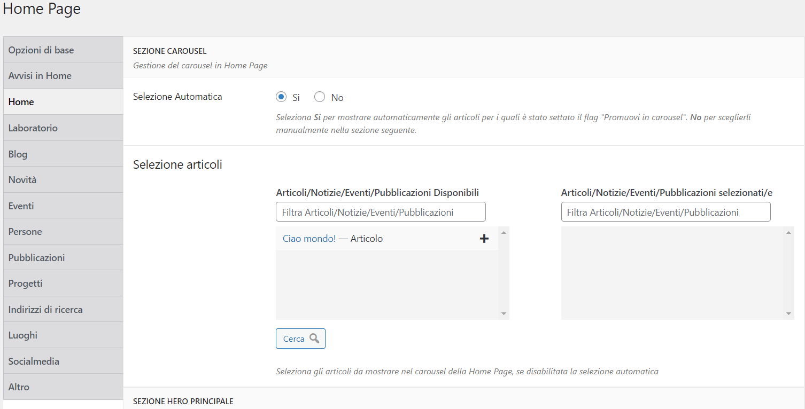
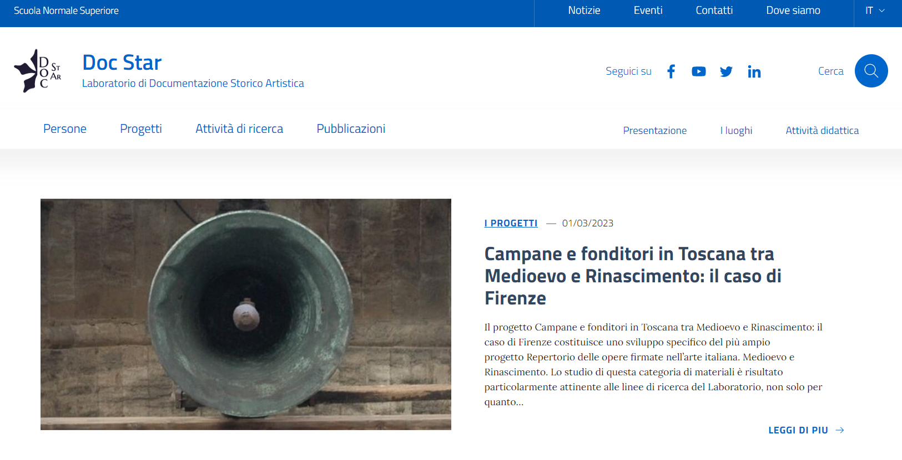
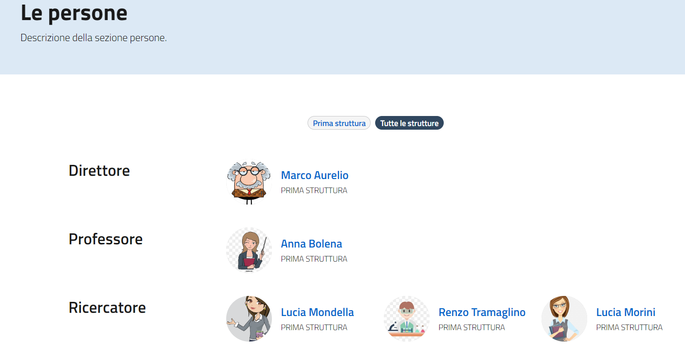
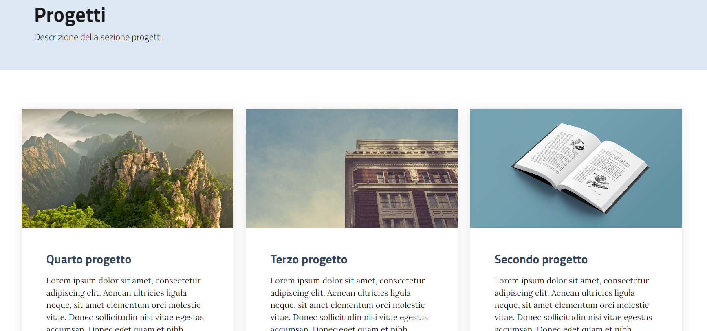
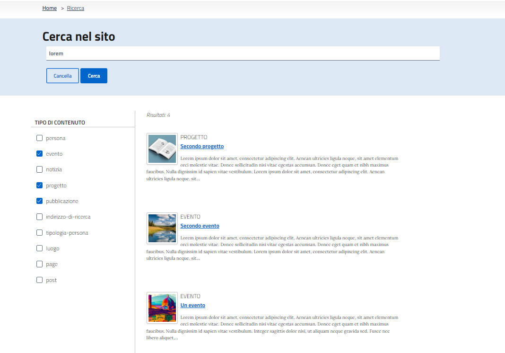
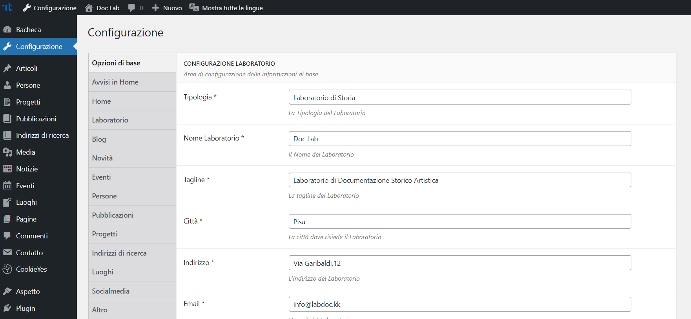

#  Design Laboratori Italia

[](https://github.com/ScuolaNormaleSuperiore/design-laboratori-wordpress-theme/actions/workflows/ci.yml)
[](https://scorecard.dev/viewer/?uri=github.com/ScuolaNormaleSuperiore/design-laboratori-wordpress-theme)
[](https://phpstan.org/)
[](LICENSE)
[](https://github.com/ScuolaNormaleSuperiore/design-laboratori-wordpress-theme/tags)

**Design laboratori e centri di ricerca** è un tema WordPress basato sul modello di siti per le scuole italiane e sviluppato dalla ***Scuola Normale Superiore*** con l'obiettivo di creare un modello di sito per le strutture di ricerca (centri e laboratori). Una volta installato, l'ambiente offre una serie di contenuti predefiniti che rendono semplice e veloce l'allestimento del sito. Questo tema permette di pubblicare tutte le informazioni relative a una struttura di ricerca: personale afferente organizzato per struttura, pubblicazioni, progetti di ricerca, attività di ricerca (aggregazione di progetti) oltre a news ed eventi correlati alle attività.
Il progetto si pone l'obiettivo di dare evidenza e valore alle attività e al personale di ricerca delle strutture.

## Stato del progetto
Il progetto è in fase di produzione.

## Credits
Il progetto nasce da un fork del tema [**Design Scuole Italia**](https://developers.italia.it/it/software/istsc_blps020006-italia-design-scuole-wordpress-theme.html) e utilizza la libreria [***Bootstrap Italia***](https://italia.github.io/bootstrap-italia/). Tutti i plugin e le librerie utilizzate dal tema sono elencate nel file [CREDITS.txt](https://github.com/ScuolaNormaleSuperiore/design-laboratori-wordpress-theme/blob/main/CREDITS.txt).

## Funzionalità
- Popolamento automatico del sito (pagine e menu).
- Sezione per la configurazione del tema e dei contenuti.
- Personalizzazione del layout della home page.
- Gestione delle persone del laboratorio.
- Gestione dei progetti del laboratorio.
- Gestione delle news e degli eventi del laboratorio.
- Gestione dei luoghi del laboratorio.
- Gestione delle pubblicazioni del laboratorio.
- Gestione degli indirizzi di ricerca.
- Gestione dei brevetti del laboratorio.
- Gestione degli spin-off del laboratorio.
- Gestione delle risorse tecniche del laboratorio.
- Gestione del blog del laboratorio.
- Pagine di archivio con paginazione.
- Ricerca in tutti i contenuti del sito, con suggerimenti autocomplete opzionali.
- Gestione degli avvisi in home page.
- Gestione dei cookie.
- Form di contatti.
- Mappa del sito in HTML e XML.
- Gestione hero in home page.
- Carousel in home page con contenuti selezionabili.
- Gestione contenuti in evidenza in home page.
- Gestione sezioni eventi, news e pubblicazioni in home page.
- Sezioni della home che elencano pagine: card di navigazione, navigazione per pagine, indice di una pagina e pannello a tab (italiano e inglese).
- Gestione banner in home page.
- Sezioni video in home page, ciascuna con il proprio indirizzo YouTube.
- Gestione sponsor in home page.
- Manifest PWA installabile (senza service worker).
- Supporto delle lingue italiano e inglese.
- Integrazione con il software di gestione delle newsletter Brevo.
- Importazione degli eventi da Indico.
- Importazione dei brevetti da IRIS.
- Importazione di un albero di pagine da file CSV, con simulazione e conferma.
- Importazione delle persone da file CSV, con simulazione.

## Galleria

**Immagine 1:** Backoffice: configurazione del carousel.


**Immagine 2:** Homepage con carousel.


**Immagine 3:** Le persone del laboratorio.


**Immagine 4:** I progetti del laboratorio.


**Immagine 5:** La ricerca nel sito.


## Requisiti software
1. Il CMS WordPress (versione >= 6.6.2).
2. PHP >= 8.0.
3. Per lo sviluppo: [Composer](https://getcomposer.org/), Node.js e npm.

## Dipendenze
Per il corretto funzionamento del tema è necessario installare i seguenti plugin:
* [ACF OpenStreetMap Field](https://wordpress.org/plugins/acf-openstreetmap-field)
* [Advanced Custom Fields](https://wordpress.org/plugins/advanced-custom-fields)
* [Polylang](https://it.wordpress.org/plugins/polylang)
* [WP Mail SMTP](https://it.wordpress.org/plugins/wp-mail-smtp)
* [Really Simple CAPTCHA](https://it.wordpress.org/plugins/really-simple-captcha)

Il tema mostra un avviso quando uno di questi plugin non è installato.

## Installazione e configurazione del tema
Dopo aver installato WordPress su un server, per installare e configurare il tema **Design laboratori e centri di ricerca** è necessario seguire i seguenti passi:

1. Scaricare il tema ["Design Laboratori Italia"](https://github.com/ScuolaNormaleSuperiore/design-laboratori-wordpress-theme.git).
2. Copiare la cartella ***design-laboratori-wordpress-theme*** in *<installazione_wordpress>/wp-content/themes/*
3. Attivare il tema (creazione automatica dei contenuti e dei menu di default).
4. Installare e attivare i plugin dipendenti (un popup mostra l'elenco dei plugin richiesti).
5. Configurazione di Polylang usando il wizard del plugin:

	5.1 Andare in *WP->Lingue->Configurazione* e aggiungere le lingue italiano (default) e inglese.

	5.2 Impostare: *Permetti a Polylang di tradurre i media*.

	5.3 Impostare *Scegli la lingua da assegnare* = it.

6. Creazione dei contenuti di default: *WP->Strumenti DLI->Utilità-> Ricarica i dati di attivazione (menu, pagine, tassonomie, etc)*
7. In *WP->Aspetto->Menu* cliccare su **Salva menu**.
8. Configurazione del tema: andare in *WP->Configurazione* e impostare i dati di configurazione.

**Immagine 6:** Backoffice: configurazione del tema.


## Ruoli e permessi
Installando il tema viene aggiunto un ruolo chiamato **Super Editor** che ha gli stessi permessi di un Editor, con in più il permesso di configurare il tema (WP->Configurazione) e quello di modificare il menu del tema (WP->Aspetto).

## Stile del sito
In *WP->Configurazione->Altro->Stile del sito* è possibile scegliere lo stile
Bootstrap Italia standard oppure quello personalizzato del tema. Lo stile
personalizzato applica i colori del brand del tema; i font restano quelli
predefiniti di Bootstrap Italia salvo personalizzazioni CSS esplicite. Per
modificare colori, font o CSS compilato seguire la [guida alla
personalizzazione dello stile](DOC/HowTo/Personalizzazione-stile.md).

## Documentazione

Le guide di installazione, configurazione, gestione e sviluppo sono pubblicate
nel sito della [documentazione di Design Laboratori Italia](https://scuolanormalesuperiore.github.io/design-laboratori-wordpress-theme/).
Le sorgenti Markdown restano disponibili nella cartella [`DOC/`](DOC/).

## Demo
### Sito di prova online
Un sito di test, che mostra le principali funzionalità del sistema, è disponibile qui: [Sito Federato DEV](https://sitofederato.sns.it).

### Docker
È possibile provare facilmente il tema in locale con Docker, in un ambiente
completo di WordPress, plugin e contenuti dimostrativi. Seguire la [guida alla
demo Docker](SETUP/Docker/README.md).

## Siti in produzione
Alcuni siti in produzione realizzati con questo tema:
* [Istituto di Studi Avanzati "Carlo Azeglio Ciampi"](https://istitutociampi.sns.it)
* [POCKET - Knowledge Transfer Office](https://kto.sns.it)
* [EDEV PRO 3](https://edevpro3.sns.it)
* [Bio@SNS (Laboratorio di Biologia)](https://laboratoriobiologia.sns.it)
* [Il PNRR alla Normale](https://pnrr.sns.it)
* [FROID (Corso di dottorato in Filologia Romanza e Italiana Digitale)](https://froid.sns.it)
* [Centro di ricerca Matematica Ennio De Giorgi](https://crmdegiorgi.sns.it)

## Catalogo del riuso
Il progetto è pubblicato sul catalogo del riuso di Developers Italia. La home page del progetto è [questa](https://catalogo-software.developers.italia.it/software/9f2ec6c8-9eb7-4d73-8d79-577e62308e9a).

## Sviluppo e verifiche

Dalla radice del tema, installare le dipendenze di sviluppo con:

```sh
npm ci
composer install
```

Gli strumenti di verifica sono di tre famiglie: **Controlli statici** (leggono il codice), **Test** (con asserzioni: passano o falliscono) e **Report** (fotografano un sito in funzione e producono un risultato da leggere). I Controlli statici e i Test si lanciano con Composer, i Report con npm.

| Famiglia | Comando | Cosa fa |
|---|---|---|
| Controlli statici | `composer run lint:php` (`lint:php:fix` per le correzioni automatiche) | Stile del codice PHP (standard WordPress). Il hook `pre-commit` lo esegue sui file in staging e blocca il commit se ci sono errori |
| | `composer run lint:phpstan` | Analisi statica con [PHPStan](tests/phpstan/README.md), livello 5 |
| | `composer audit`, `npm audit --omit=dev` | Vulnerabilità note delle dipendenze |
| Test | `composer test:unit` | [Funzioni pure, configurazioni e coerenza dei file di rilascio](tests/unit/README.md), senza WordPress. Il hook `pre-commit` li esegue a ogni commit |
| | `composer test:integration` | [Comportamento che dipende da WordPress](tests/integration/README.md), su un WordPress di test con ACF e Polylang reali e un database dedicato |
| | `composer test:e2e` | [Browser (Playwright) su un sito Local dedicato](tests/e2e/README.md) |
| Report | `npm run status:scan -- <url>` | [Errori HTTP, PHP e JavaScript, risorse non caricate, prestazioni, overflow a 320 px](tests/report/status-report/README.md) |
| | `npm run html:scan -- <url>` | [Validità dell'HTML (Nu Html Checker)](tests/report/html-report/README.md) |
| | `npm run pa11y:scan -- <url>` | [Accessibilità WCAG 2 AA a 1280 px e a 320 px](tests/report/pa11y-report/README.md) |

I controlli che scattano a ogni commit (segreti, PHPStan livello 5, PHPCS sui file in staging, test unit, testo del messaggio) sono elencati in [Cosa controlla il commit](tests/README.md#cosa-controlla-il-commit). A ogni push su GitHub il workflow *CI* ripete su una macchina pulita i controlli principali, anche su PHP 8.0, il minimo richiesto dal tema; esegue inoltre i test di integrazione su `dev` e `main`, sulle pull request verso `main` e su avvio manuale. Segnala i problemi ma non blocca né i push né i merge (vedi [Controlli in CI](tests/README.md#controlli-in-ci-github-actions)).

Requisiti, preparazione, opzioni e varianti `:gate` e `:compare` sono descritti nel [punto di ingresso dei controlli](tests/README.md), che rimanda ai README di [test unit](tests/unit/README.md), [integrazione](tests/integration/README.md), [E2E](tests/e2e/README.md), [PHPStan](tests/phpstan/README.md) e [Report](tests/report/README.md). [Test e Report](tests/) sono nel repository clonato ma **non** nel pacchetto zip scaricato da GitHub per ogni versione (`export-ignore` in [.gitattributes](.gitattributes)).

## Verifica file publiccode.yml
Il file ***publiccode.yml*** serve per la pubblicazione del progetto nel [catalogo del riuso](https://catalogo-software.developers.italia.it/software/9f2ec6c8-9eb7-4d73-8d79-577e62308e9a). Per verificare la sua correttezza si può usare questa [procedura](https://github.com/italia/publiccode-parser-go); l'opzione `-path .` controlla i file referenziati (logo, screenshot) nella cartella locale invece che nel repository remoto.
```
go install github.com/italia/publiccode-parser-go/v4/publiccode-parser@latest
cd <root_cartella_tema>
publiccode-parser -path . publiccode.yml
```

## Contesto di progetto per l'AI
Chiedere all'assistente di codifica di "leggere il contesto del progetto". ChatGPT/Codex legge prima `AGENTS.md`, mentre Claude Code legge prima `CLAUDE.md`; entrambi seguono poi, nell'ordine, `AGENTS/AI_BOOTSTRAP.md`, `AGENTS/PROJECT.md`, `AGENTS/ARCHITECTURE.md`, `AGENTS/AI_BEHAVIOR.md`, `AGENTS/CODING_STANDARDS.md` e `AGENTS/GIT_WORKFLOW.md`. Il bootstrap garantisce l'esistenza dei file issue locali senza leggerli; `AGENTS/CODE_REVIEW.md` viene letto solo da `/code-review`. Se disponibile, legge anche l'indice privato `DEV/TODO/README.md` e mostra i piani in esecuzione; se `DEV/TODO` non è accessibile, prosegue senza errore. Infine conferma il bootstrap, elenca le skill disponibili, indica se il server MCP `design-system-italia` è installato e utilizzabile e chiede su cosa lavorare.

## Tickets e bug-fixing
Per segnalare dei bug utilizzare la sezione [Issues](https://github.com/ScuolaNormaleSuperiore/design-laboratori-wordpress-theme/issues) del repository del progetto.

Per segnalare una **vulnerabilità di sicurezza** non aprire una issue pubblica: seguire la [policy di sicurezza](SECURITY.md) e usare la segnalazione privata delle vulnerabilità di GitHub.

## Come contribuire
I contributi sono benvenuti. Prima di aprire una issue o una pull request leggere [CONTRIBUTING.md](CONTRIBUTING.md).

## Sviluppi futuri
Gli sviluppi previsti per le prossime versioni sono elencati nella sezione
[TODO del changelog](CHANGELOG.md#todo).

## Licenza
Il progetto è distribuito con licenza **GNU General Public License v3.0 or later** (`GPL-3.0-or-later`).
Il testo integrale della licenza è nel file [LICENSE](https://github.com/ScuolaNormaleSuperiore/design-laboratori-wordpress-theme/blob/main/LICENSE).

## Copyright
1. Detentore copyright: *Scuola Normale Superiore*.
2. Responsabili del progetto: Michele Fiaschi, Marcella Monreale e Claudio Battaglino.
3. Il progetto è stato realizzato con la collaborazione dell'***Ufficio comunicazione*** e del ***laboratorio Doc Star*** della *Scuola Normale Superiore*.
