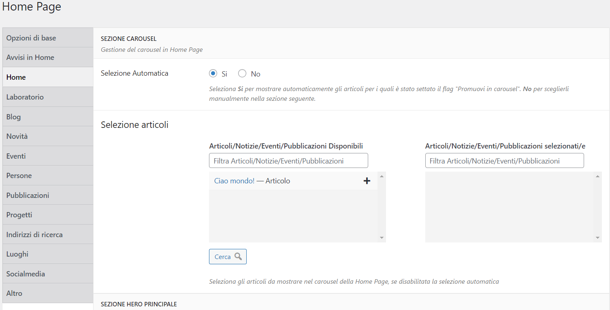
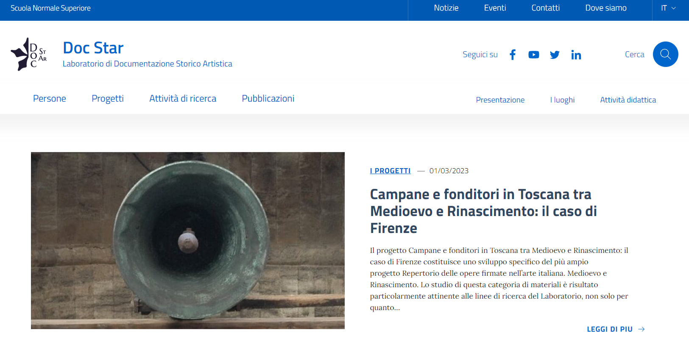
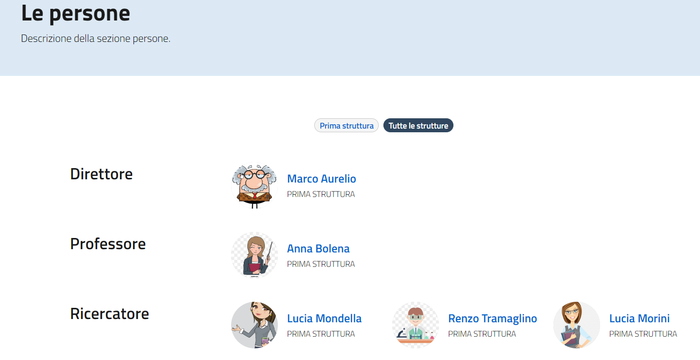
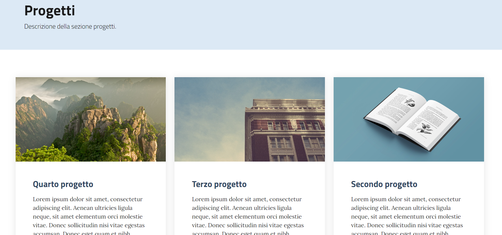
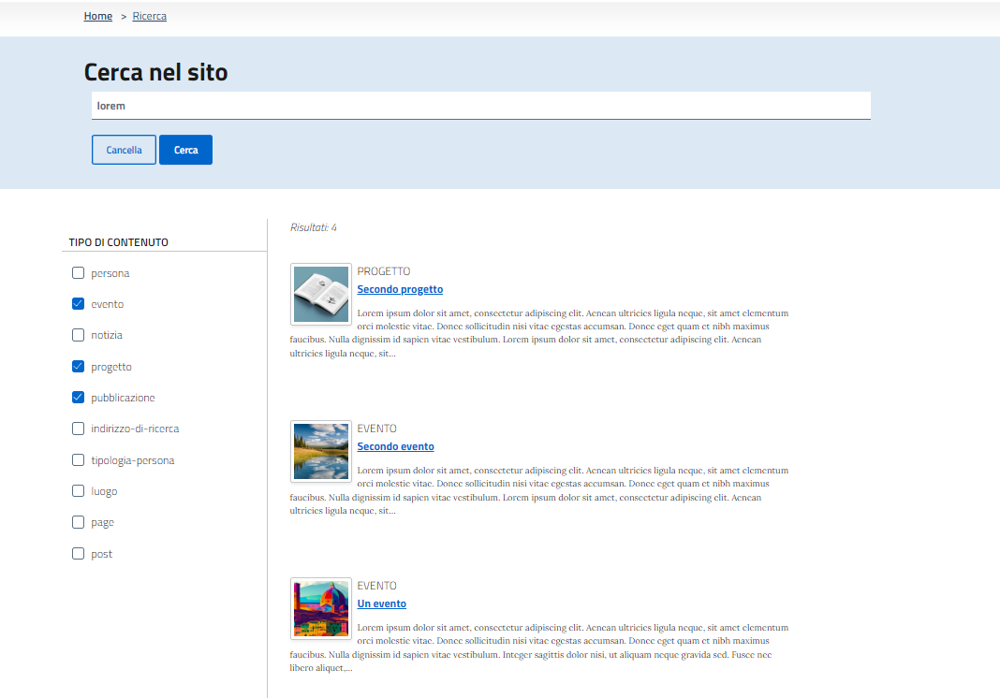
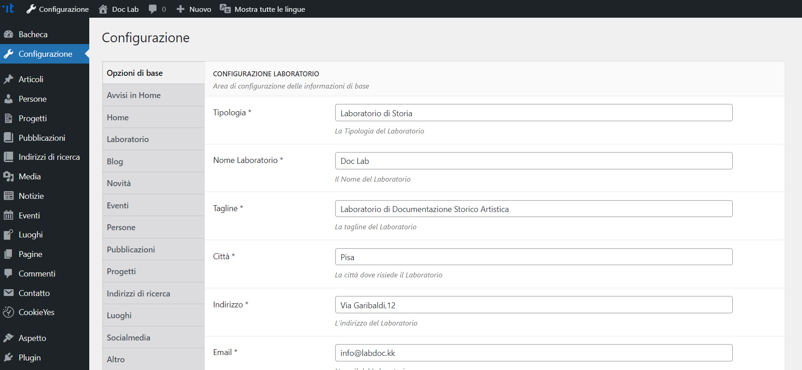

#  Design Laboratori Italia


**Design laboratori e centri di ricerca** è un tema WordPress basato sul modello di siti per le scuole italiane e sviluppato dalla ***Scuola Normale Superiore*** con l'obiettivo di creare un modello di sito per le strutture di ricerca (centri e laboratori). Una volta installato, l'ambiente offre una serie di contenuti predefiniti che rendono semplice e veloce l'allestimento del sito. Questo tema permette di pubblicare tutte le informazioni relative a una struttura di ricerca: personale afferente organizzato per struttura, pubblicazioni, progetti di ricerca, attività di ricerca (aggregazione di progetti) oltre a news ed eventi correlati alle attività.
Il progetto si pone l'obiettivo di dare evidenza e valore alle attività e al personale di ricerca delle strutture.

## Stato del progetto
Il progetto è in fase di produzione.

## Credits
Il progetto nasce da un fork del tema [**Design Scuole Italia**](https://developers.italia.it/it/software/istsc_blps020006-italia-design-scuole-wordpress-theme.html) e utilizza la libreria [***Bootstrap Italia***](https://italia.github.io/bootstrap-italia/). Tutti i plugin e le librerie utilizzate dal tema sono elencate nel file [CREDITS.txt](https://github.com/ScuolaNormaleSuperiore/design-laboratori-wordpress-theme/blob/main/CREDITS.txt).

## Funzionalità
- Popolamento automatico del sito (pagine e menu).
- Sezione per la configurazione del tema e dei contenuti.
- Personalizzazione del layout della home page.
- Gestione delle persone del laboratorio.
- Gestione dei progetti del laboratorio.
- Gestione delle news e degli eventi del laboratorio.
- Gestione dei luoghi del laboratorio.
- Gestione delle pubblicazioni del laboratorio.
- Gestione degli indirizzi di ricerca.
- Gestione dei brevetti del laboratorio.
- Gestione degli spin-off del laboratorio.
- Gestione delle risorse tecniche del laboratorio.
- Gestione del blog del laboratorio.
- Pagine di archivio con paginazione.
- Ricerca in tutti i contenuti del sito, con suggerimenti autocomplete opzionali.
- Gestione degli avvisi in home page.
- Gestione dei cookie.
- Form di contatti.
- Mappa del sito in HTML e XML.
- Gestione hero in home page.
- Carousel in home page con contenuti selezionabili.
- Gestione contenuti in evidenza in home page.
- Gestione sezioni eventi, news e pubblicazioni in home page.
- Gestione banner in home page.
- Gestione sponsor in home page.
- Manifest PWA installabile (senza service worker).
- Supporto delle lingue italiano e inglese.
- Integrazione con il software di gestione delle newsletter Brevo.
- Importazione degli eventi da Indico.
- Importazione dei brevetti da IRIS.

## Galleria

**Immagine 1:** Backoffice: configurazione del carousel.


**Immagine 2:** Homepage con carousel.


**Immagine 3:** Le persone del laboratorio.


**Immagine 4:** I progetti del laboratorio.


**Immagine 5:** La ricerca nel sito.


## Requisiti software
1. Il CMS WordPress (versione >= 6.6.2).
2. PHP >= 8.0.
3. Per lo sviluppo: [Composer](https://getcomposer.org/), Node.js e npm.

## Dipendenze
Per il corretto funzionamento del tema è necessario installare i seguenti plugin:
* [ACF OpenStreetMap Field](https://wordpress.org/plugins/acf-openstreetmap-field)
* [Advanced Custom Fields](https://wordpress.org/plugins/advanced-custom-fields)
* [Better Aria Label Support](https://wordpress.org/plugins/better-aria-label-support)
* [Polylang](https://it.wordpress.org/plugins/polylang)
* [WP Mail SMTP](https://it.wordpress.org/plugins/wp-mail-smtp)
* [Really Simple CAPTCHA](https://it.wordpress.org/plugins/really-simple-captcha)

Il tema mostra un avviso quando uno di questi plugin non è installato.

## Installazione e configurazione del tema
Dopo aver installato WordPress su un server, per installare e configurare il tema **Design laboratori e centri di ricerca** è necessario seguire i seguenti passi:

1. Scaricare il tema ["Design Laboratori Italia"](https://github.com/ScuolaNormaleSuperiore/design-laboratori-wordpress-theme.git).
2. Copiare la cartella ***design-laboratori-wordpress-theme*** in *<installazione_wordpress>/wp-content/themes/*
3. Attivare il tema (creazione automatica dei contenuti e dei menu di default).
4. Installare e attivare i plugin dipendenti (un popup mostra l'elenco dei plugin richiesti).
5. Configurazione di Polylang usando il wizard del plugin:

	5.1 Andare in *WP->Lingue->Configurazione* e aggiungere le lingue italiano (default) e inglese.

	5.2 Impostare: *Permetti a Polylang di tradurre i media*.

	5.3 Impostare *Scegli la lingua da assegnare* = it.

6. Creazione dei contenuti di default: *WP->Strumenti DLI->Utilità-> Ricarica i dati di attivazione (menu, pagine, tassonomie, etc)*
7. In *WP->Aspetto->Menu* cliccare su **Salva menu**.
8. Configurazione del tema: andare in *WP->Configurazione* e impostare i dati di configurazione.

**Immagine 6:** Backoffice: configurazione del tema.


## Ruoli e permessi
Installando il tema viene aggiunto un ruolo chiamato **Super Editor** che ha gli stessi permessi di un Editor, con in più il permesso di configurare il tema (WP->Configurazione) e quello di modificare il menu del tema (WP->Aspetto).

## Personalizzazione dello stile (colori e font)
In *WP->Configurazione->Altro->Stile del sito* è possibile scegliere tra:
* **Stile Bootstrap Italia standard**: colori e font predefiniti della libreria Bootstrap Italia.
* **Stile personalizzato**: il CSS base [bootstrap-italia-custom.min.css](assets/css/bootstrap-italia-custom.min.css) con gli override del brand in [custom-colors.css](assets/css/custom-colors.css).

Bootstrap Italia 3 gestisce la tematizzazione tramite custom property CSS `--bsi-*`. Per modificare colori e font del brand intervenire in [custom-colors.css](assets/css/custom-colors.css). Il file Sass [bootstrap-italia-custom.scss](assets/scss/bootstrap-italia-custom.scss) serve a rigenerare il CSS base, ma non sostituisce gli override del brand.

Per preparare l'ambiente locale eseguire `npm ci`, quindi usare `npm run update_layout_win` su Windows oppure `npm run update_layout_linux` su Linux quando si deve rigenerare il CSS compilato. Per aggiornare Bootstrap Italia vedere la guida indicata nella sezione [Documentazione](#documentazione).

Altre risorse utili:
* [Personalizzazione della libreria](https://italia.github.io/bootstrap-italia/docs/come-iniziare/personalizzazione-della-libreria).
* [Tool per codifica colori](https://rgb.to/).
* [Google Fonts](https://fonts.google.com).

## Documentazione

### Manuali operatore
- [Manuale operatore](https://github.com/ScuolaNormaleSuperiore/design-laboratori-wordpress-theme/blob/main/DOC/Manuali/manuale-operatore.md) — guida generale alla gestione del sito.
- [Manuale operatore: persone](https://github.com/ScuolaNormaleSuperiore/design-laboratori-wordpress-theme/blob/main/DOC/Manuali/manuale-operatore-persone.md)
- [Pannello di configurazione](https://github.com/ScuolaNormaleSuperiore/design-laboratori-wordpress-theme/blob/main/DOC/Manuali/Manuale-Utente-Pannello-Configurazione.md)

### Manuali di gestione dei contenuti
- [Attività di ricerca](https://github.com/ScuolaNormaleSuperiore/design-laboratori-wordpress-theme/blob/main/DOC/Manuali/Manuale-Gestione-Contenuti-Attivita-di-Ricerca.md)
- [Banner](https://github.com/ScuolaNormaleSuperiore/design-laboratori-wordpress-theme/blob/main/DOC/Manuali/Manuale-Gestione-Contenuti-Banner.md)
- [Blog](https://github.com/ScuolaNormaleSuperiore/design-laboratori-wordpress-theme/blob/main/DOC/Manuali/Manuale-Gestione-Contenuti-Blog.md)
- [Brevetti](https://github.com/ScuolaNormaleSuperiore/design-laboratori-wordpress-theme/blob/main/DOC/Manuali/Manuale-Gestione-Contenuti-Brevetti.md)
- [Eventi](https://github.com/ScuolaNormaleSuperiore/design-laboratori-wordpress-theme/blob/main/DOC/Manuali/Manuale-Gestione-Contenuti-Eventi.md)
- [Lingue](https://github.com/ScuolaNormaleSuperiore/design-laboratori-wordpress-theme/blob/main/DOC/Manuali/Manuale-Gestione-Contenuti-Lingue.md)
- [Luoghi](https://github.com/ScuolaNormaleSuperiore/design-laboratori-wordpress-theme/blob/main/DOC/Manuali/Manuale-Gestione-Contenuti-Luoghi.md)
- [Notizie](https://github.com/ScuolaNormaleSuperiore/design-laboratori-wordpress-theme/blob/main/DOC/Manuali/Manuale-Gestione-Contenuti-Notizie.md)
- [Progetti](https://github.com/ScuolaNormaleSuperiore/design-laboratori-wordpress-theme/blob/main/DOC/Manuali/Manuale-Gestione-Contenuti-Progetti.md)
- [Pubblicazioni](https://github.com/ScuolaNormaleSuperiore/design-laboratori-wordpress-theme/blob/main/DOC/Manuali/Manuale-Gestione-Contenuti-Pubblicazioni.md)
- [Risorse tecniche](https://github.com/ScuolaNormaleSuperiore/design-laboratori-wordpress-theme/blob/main/DOC/Manuali/Manuale-Gestione-Contenuti-Risorse-Tecniche.md)
- [Spin-off](https://github.com/ScuolaNormaleSuperiore/design-laboratori-wordpress-theme/blob/main/DOC/Manuali/Manuale-Gestione-Contenuti-Spin-off.md)

### Schemi
- [Schema dei contenuti e delle tassonomie](https://github.com/ScuolaNormaleSuperiore/design-laboratori-wordpress-theme/blob/main/DOC/Schemi/Schema-Contenuti-SitoFederato.pdf)
- [Schema di importazione degli eventi](https://github.com/ScuolaNormaleSuperiore/design-laboratori-wordpress-theme/blob/main/DOC/Schemi/Schema-Import-Eventi.drawio.pdf)
- [Schema di integrazione con Brevo](https://github.com/ScuolaNormaleSuperiore/design-laboratori-wordpress-theme/blob/main/DOC/Schemi/Schema-Integrazione-Brevo.pdf)

### Guide tecniche
- [Aggiornare la libreria Bootstrap Italia](https://github.com/ScuolaNormaleSuperiore/design-laboratori-wordpress-theme/blob/main/DOC/HowTo/HowTo%20Aggiornare%20Bootstrap%20Italia.md)
- [Aggiornamento a Bootstrap Italia 3](https://github.com/ScuolaNormaleSuperiore/design-laboratori-wordpress-theme/blob/main/DOC/HowTo/Aggiornamento%20a%20Bootstrap%20Italia%203.md)
- [REST API del tema](https://github.com/ScuolaNormaleSuperiore/design-laboratori-wordpress-theme/blob/main/DOC/HowTo/REST-API.md)
- [Importazione dei brevetti da IRIS](https://github.com/ScuolaNormaleSuperiore/design-laboratori-wordpress-theme/blob/main/DOC/HowTo/Import%20brevettiI%20da%20RIS.md)

## Demo
### Sito di prova online
Un sito di test, che mostra le principali funzionalità del sistema, è disponibile qui: [Sito Federato DEV](https://sitofederato.sns.it).

### Docker
È possibile provare il tema usando un container *Docker* che contiene tutte le componenti software richieste (WordPress + tema + plugins + contenuti d'esempio).
Il Dockerfile da usare è: [Dockerfile](https://github.com/ScuolaNormaleSuperiore/design-laboratori-wordpress-theme/tree/main/SETUP/Docker/Dockerfile).

Il sito di prova fa riferimento a un laboratorio di esempio chiamato **Demo Lab**, che è già configurato e popolato con contenuti di prova. Lo scopo di Demo Lab è mostrare le funzionalità del sistema e poterle provare velocemente; non deve essere usato in ambienti di produzione.

I comandi da eseguire per creare ed eseguire il container sono:
- docker build -t demolab-img -f SETUP/Docker/Dockerfile SETUP/Docker
- docker run -p 80:80 -p 127.0.0.1:3306:3306 --name=demolab -d demolab-img

Per collegarsi alla shell del container, eseguire il comando:
- docker exec -it demolab /bin/bash

L'URL del sito appena creato è: http://localhost/ .

Per autenticarsi come amministratore del sito l'URL è http://localhost/wp-admin/ e l'account per accedere è: manager / password

Sul container è installato il tool *Adminer* per gestire le tabelle del database.
L'URL di *Adminer* è: http://localhost/adminer.php
Per configurarlo i parametri sono:
- System: Mysql
- Server: 127.0.0.1
- Utente: admin
- Password: admin
- Database: demolabdb

## Siti in produzione
Alcuni siti in produzione realizzati con questo tema:
* [Istituto di Studi Avanzati "Carlo Azeglio Ciampi"](https://istitutociampi.sns.it)
* [POCKET - Knowledge Transfer Office](https://kto.sns.it)
* [EDEV PRO 3](https://edevpro3.sns.it)
* [Bio@SNS (Laboratorio di Biologia)](https://laboratoriobiologia.sns.it)
* [Il PNRR alla Normale](https://pnrr.sns.it)
* [FROID (Corso di dottorato in Filologia Romanza e Italiana Digitale)](https://froid.sns.it)
* [Centro di ricerca Matematica Ennio De Giorgi](https://crmdegiorgi.sns.it)

## Repository
[Questo](https://github.com/ScuolaNormaleSuperiore/design-laboratori-wordpress-theme) è il repository che contiene il codice sorgente del progetto.

## Catalogo del riuso
Il progetto è pubblicato sul catalogo del riuso di Developers Italia. La home page del progetto è [questa](https://catalogo-software.developers.italia.it/software/9f2ec6c8-9eb7-4d73-8d79-577e62308e9a).

## Sviluppo e verifiche

Dalla radice del tema, installare le dipendenze di sviluppo con:

```sh
npm ci
composer install
```

Eseguire i controlli dalla radice del tema:

- `composer run lint:php` (oppure `npm run lint:php`) — verifica il codice PHP rispetto agli standard di codifica WordPress configurati; `npm run lint:php:fix` corregge automaticamente le violazioni risolvibili.
- `composer run lint:phpstan` — esegue l'analisi statica con PHPStan.
- `composer test:unit` — esegue i test unit (PHPUnit, senza WordPress, pochi secondi): funzioni pure, tabelle di configurazione e coerenza dei file di rilascio (versione e data in `VERSION.txt`, `style.css`, `package.json`, `publiccode.yml`, `CHANGELOG.md`). Il hook `pre-commit` li esegue a ogni commit e blocca il commit se uno fallisce. Dettagli in `tests/unit/README.md`.
- `npm run status:scan -- https://mio-sito.example.com` — scandisce la mappa del sito e segnala errori HTTP, PHP e JavaScript, problemi di caricamento delle risorse e di prestazioni delle pagine.
- `npm run status:scan:gate -- https://mio-sito.example.com` — esegue la stessa scansione e termina con codice 1 se almeno una pagina ha errori (un overflow a 320 px è solo un avviso).
- `npm run html:scan -- https://mio-sito.example.com` — valida l'HTML delle pagine renderizzate con Nu Html Checker.
- `npm run html:scan:gate -- https://mio-sito.example.com` — esegue la stessa validazione HTML e termina con un codice di errore se il risultato è negativo, quindi è adatto come quality gate.
- `npm run pa11y:scan -- https://mio-sito.example.com` — verifica l'accessibilità (WCAG 2 AA, motori axe e HTML CodeSniffer) di ogni pagina della sitemap, a 1280 px e a 320 px.
- `npm run pa11y:scan:gate -- https://mio-sito.example.com` — conta solo gli errori WCAG e termina con codice 2 se ce ne sono oltre la soglia (`--threshold N`), quindi è adatto come quality gate.
- `npm run status:compare` e `npm run html:compare` — confrontano le due scansioni più recenti (`pa11y` non ha un comando di confronto).
- `composer audit` e `npm audit --omit=dev` — segnalano le vulnerabilità note delle dipendenze.

I test e gli scanner sono nel repository clonato ma **non** nel pacchetto zip scaricato da GitHub per ogni versione (`export-ignore` in `.gitattributes`). La panoramica è in `tests/README.md`.

Gli scanner `status`, `html` e `pa11y` producono report (HTML e JSON) senza asserzioni pass/fail e si trovano in `tests/report/`. Per quelli che aprono le pagine nel browser, installare una sola volta Chromium con `npm run status:scan:install-browser`. Opzioni, risultati e confronti tra le esecuzioni sono descritti nei README delle cartelle `tests/report/*/`.

## Verifica file publiccode.yml
Il file ***publiccode.yml*** serve per la pubblicazione del progetto nel [catalogo del riuso](https://catalogo-software.developers.italia.it/software/9f2ec6c8-9eb7-4d73-8d79-577e62308e9a). Per verificare la sua correttezza si può usare questa [procedura](https://github.com/italia/publiccode-parser-go); l'opzione `-path .` controlla i file referenziati (logo, screenshot) nella cartella locale invece che nel repository remoto.
```
go install github.com/italia/publiccode-parser-go/v4/publiccode-parser@latest
cd <root_cartella_tema>
publiccode-parser -path . publiccode.yml
```

## Contesto di progetto per l'AI
Chiedere all'assistente di codifica di "leggere il contesto del progetto". Legge prima `AGENTS.md` (Codex) o `CLAUDE.md` (Claude Code), poi, nell'ordine, `AGENTS/AI_BOOTSTRAP.md`, `AGENTS/PROJECT.md`, `AGENTS/ARCHITECTURE.md`, `AGENTS/AI_BEHAVIOR.md`, `AGENTS/CODING_STANDARDS.md` e `AGENTS/GIT_WORKFLOW.md`. Garantisce l'esistenza dei file issue locali senza leggerli; `AGENTS/CODE_REVIEW.md` viene letto solo da `/code-review`. Infine conferma il bootstrap, elenca le skill disponibili, indica se il server MCP `design-system-italia` è installato e utilizzabile e chiede su cosa lavorare.

## Tickets e bug-fixing
Per segnalare dei bug utilizzare la sezione [Issues](https://github.com/ScuolaNormaleSuperiore/design-laboratori-wordpress-theme/issues) del repository del progetto.

Per segnalare una **vulnerabilità di sicurezza** non aprire una issue pubblica: seguire la [policy di sicurezza](SECURITY.md) e usare la segnalazione privata delle vulnerabilità di GitHub.

## Come contribuire
I contributi sono benvenuti. Prima di aprire una issue o una pull request leggere [CONTRIBUTING.md](CONTRIBUTING.md).

## Sviluppi futuri
Queste sono le principali funzionalità previste per le prossime versioni del sistema:
* Autenticazione degli operatori tramite LDAP.
* Autenticazione degli operatori tramite Shibboleth.

## Licenza
Il progetto è distribuito con licenza **GNU General Public License v3.0 or later** (`GPL-3.0-or-later`).
Il testo integrale della licenza è nel file [LICENSE](https://github.com/ScuolaNormaleSuperiore/design-laboratori-wordpress-theme/blob/main/LICENSE).

## Copyright
1. Detentore copyright: *Scuola Normale Superiore*.
2. Responsabili del progetto: Michele Fiaschi, Marcella Monreale e Claudio Battaglino.
3. Il progetto è stato realizzato con la collaborazione dell'***Ufficio comunicazione*** e del ***laboratorio Doc Star*** della *Scuola Normale Superiore*.
